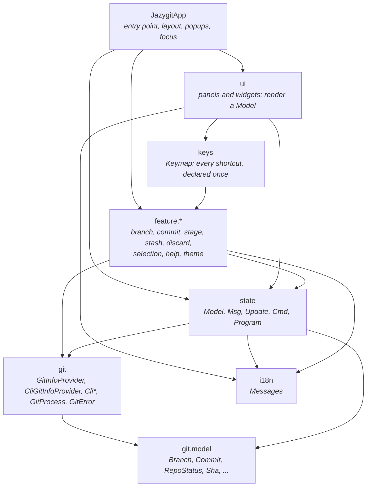
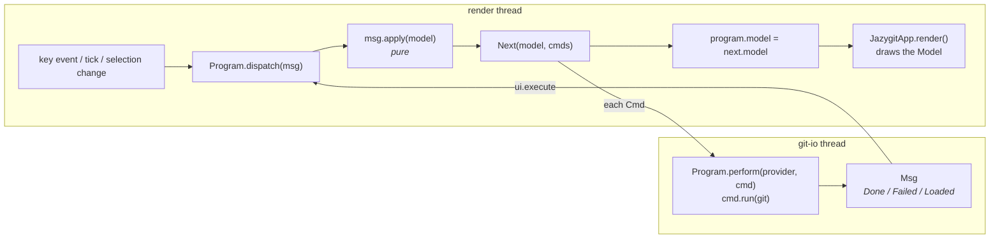
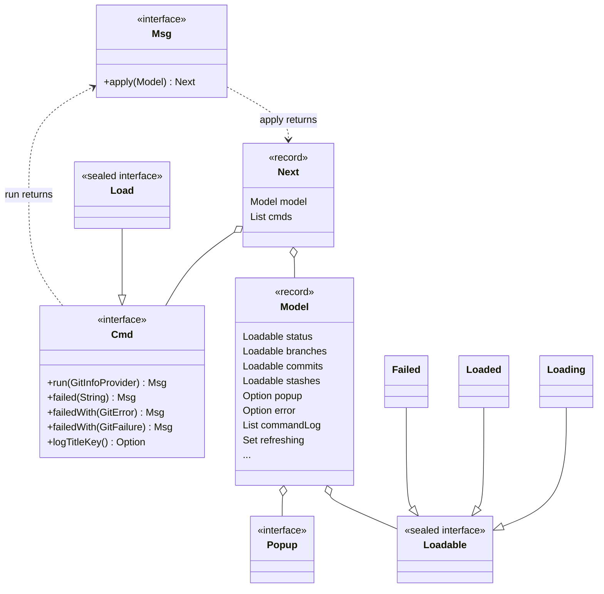
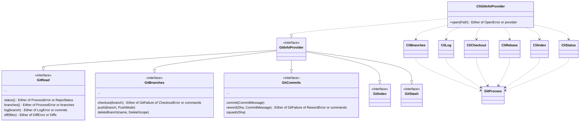
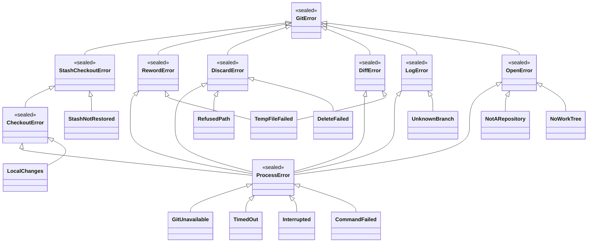
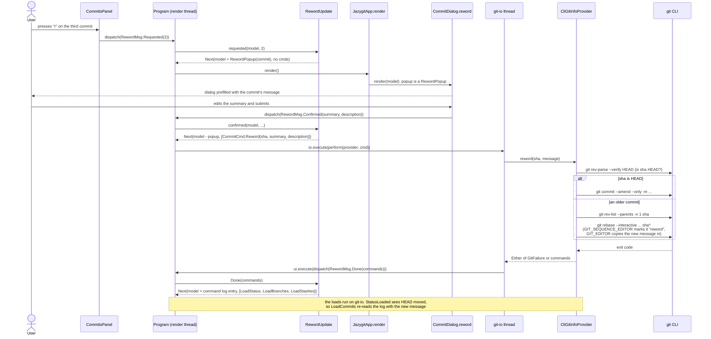
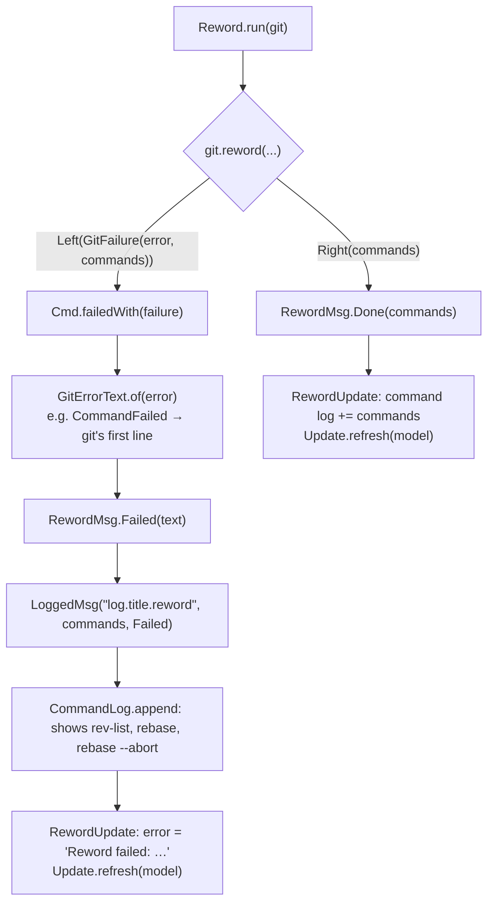

# jazygit architecture

jazygit is a lazygit-style terminal UI for git, built on [TamboUI](https://github.com/tamboui).
It follows the **Elm architecture**:

- The whole UI state is one immutable `Model`.
- Every event (a key press, a tick, a git result) is a `Msg`.
- A pure update function turns `(Model, Msg)` into the next `Model` plus the IO to perform, as `Cmd`
  values.
- Commands run against git on a background thread, and their outcome comes back as a new `Msg`.

Rendering never talks to git, and update functions never do IO.

## Packages



| Package | Responsibility |
|---|---|
| `JazygitApp` | Opens the repository, starts the `Program`, lays out the panes, shows the open popup and moves the focus. |
| `ui` | Panels (`FilesPanel`, `BranchesPanel`, `CommitsPanel`, `ContentPanel`, `CommandLogPanel`, ...) that render a `Model` and turn key events into `Msg`s. |
| `keys` | `Keymap`: the keys of each panel (`Scope`) and the global keys. Panels react to keys from it, and the help popup lists them from it. |
| `feature.*` | One package per feature. Each one holds the feature's messages, its update functions, its commands, and its popups, dialogs and keys. |
| `state` | The Elm core: `Model`, `Msg`, `Update`, `Cmd`, `Program`, `Loadable`, the command log and `GitErrorText`. |
| `git` | Everything that touches the repository, all through the `git` command line. All results are `Either` values. |
| `git.model` | Immutable value types describing the repository. |
| `i18n` | `Messages`: the user-facing texts, from `messages.properties`. |

## The runtime loop

`Program` holds the current `Model` and owns two executors:

- **ui**: the TamboUI render thread. It is the only thread that reads or replaces the model.
- **io**: a single `git-io` thread, so git commands never run concurrently.
- **background**: a `git-fetch` thread for commands that are slow and that nobody waits for
  (`Cmd.background()`), so they don't hold up the others. Today that is only the fetch.



Every 500 ms a `Msg.Tick` triggers `Update.refresh`, which re-reads the status, branches and stashes.
That keeps the screen in sync with changes made outside the app. A periodic load is skipped while an
equal one is still running: `Model.refreshing` holds the loads that are running.

Every 5 seconds a `FetchMsg.Tick` runs `git fetch --all` in the background, unless the previous fetch is
still running (`Model.fetching`). Its result reloads the branches. Neither its commands nor its failures are
shown, since it also runs while offline. `ssh` runs with `BatchMode=yes` during the fetch, so it can't prompt
for a passphrase on the terminal.

## Core types



- **`Msg` applies itself.** Each feature has a sealed sub-interface, for example `RewordMsg`, whose
  `apply` delegates to that feature's update class (`RewordUpdate`). Adding a feature therefore needs
  no change to `Update` or `Msg`.
- **`Cmd` is immutable data** that knows how to run itself against a `GitInfoProvider` and how to
  report failure:
  - `run` folds the provider's `Either` into a `Msg`.
  - `failedWith(GitFailure)` turns a failure into the failure `Msg`. When the command has a
    `logTitleKey`, it first wraps that `Msg` in a `LoggedMsg`, so the commands that ran still appear
    in the command log.
- **`Cmd.Load`** reads part of the repository into the model, as a `Loadable`.
- **Popups are part of the model.** `model.popup()` says which dialog is open. `JazygitApp` renders the
  dialog that matches it and moves the focus into it, then back to the pane it came from once
  the popup closes.
- **The command log** (`Model.commandLog`) lists every git command that changed the repository.
  `CommandLog.append` adds them when an operation reports `Done`, or when a `LoggedMsg` arrives for
  one that failed.

### The anatomy of a feature

Each feature package follows the same shape:

| Type | Example (reword) | Role |
|---|---|---|
| `XxxMsg` | `RewordMsg` | Sealed set of messages: `Requested`, `Confirmed`, `Cancelled`, `Done`, `Failed`. |
| `XxxUpdate` | `RewordUpdate` | Pure transitions for those messages. |
| `XxxCmd` | `CommitCmd.Reword` | The IO the feature asks for. |
| `XxxPopup` | `RewordPopup` | What the open dialog is about; it lives in the model. |
| `XxxDialog` | `CommitDialog.reword` | Renders the popup and dispatches `Confirmed` or `Cancelled`. |
| `XxxKeys` | `CommitKeys` | Registers the feature's keys in the `Keymap`. |

## The git layer



- **Everything goes through the `git` command line**, so the repository is read and changed exactly as
  git itself does: its configuration, hooks, credentials and repository formats included.
  - **Reads:** `CliStatus` (`git status --porcelain=v2`), `CliBranches` (one `git for-each-ref` for all
    branches, with their upstream and ahead/behind counts), `CliLog` (`git rev-parse`, `git log -z`),
    `CliStash`, `CliDiff` and `CliShow`. Each has a pure parser for git's output.
  - **Writes:** `CliCheckout`, `CliBranch`, `CliIndex`, `CliRebase` and `CliStash`.
  - **Opening:** `CliGitInfoProvider.open` asks `git rev-parse` whether the directory is in a repository,
    whether that is bare, and where its working tree is.
- **`GitProcess.run(workTree, GitCommand)`** is the only place that starts git:
  - A `GitCommand` is data: the arguments, the environment and a timeout.
  - Every command runs with `LC_ALL=C` (git's messages are matched in English) and
    `GIT_TERMINAL_PROMPT=0` (fail rather than wait for credentials).
  - It returns `Either<GitFailure<ProcessError>, Output>`.

### Errors as values

No git operation throws. A read returns `Either<E, T>`. An operation that changes the repository
returns `Either<GitFailure<E>, List<String>>`:

- On success, the right side is the command lines that ran.
- On failure, a `GitFailure` pairs the error with the command lines that ran up to and including the
  failing one.

`E` is the narrowest error type the operation can produce, so its signature lists every way it can
fail.



Some helpers combine these results:

- `GitFailure.sequence(...)` runs steps in order and stops at the first failure. That failure also
  carries the commands of the steps before it.
- `GitFailure.widen(...)` views a failure as a wider error type, for example a `ProcessError` as a
  `RewordError`.

`GitErrorText` in `state` turns an error into the text the user sees. The git package returns data,
not messages.

## Example: rewording a commit

The user selects a commit in the commits pane, presses `r`, edits the message and confirms. The flow
below shows what happens.



### Step by step

1. **Key press.**
   - `CommitKeys` registered `Binding.onSelected("r", "help.commits.reword", RewordMsg.Requested::new)`
     in the `COMMITS` scope.
   - `CommitsPanel` asks the `Keymap` to handle the key with the selected index. That yields
     `RewordMsg.Requested(index)`, which the panel dispatches.

2. **Open the dialog**, a pure step in `RewordUpdate.requested`. If the commits are loaded and the
   index is valid, the model gets a `RewordPopup(commit)` and the error is cleared. No IO is needed.

3. **Render.**
   - `JazygitApp.render` asks each dialog to render. `CommitDialog.reword` renders because
     `model.popup(RewordPopup.class)` is defined, and starts out with the commit's current message.
   - `JazygitApp` moves the focus into the dialog.

4. **Confirm**, a pure step in `RewordUpdate.confirmed`.
   - A blank summary keeps the dialog open.
   - Otherwise the popup closes and the update returns one command:
     `CommitCmd.Reword(sha, summary, description)`.

5. **Perform**, on the `git-io` thread. `Program.perform` calls `Reword.run(git)`:

   ```java
   return git.reword(sha, new CommitMessage(summary, description))
           .fold(this::failedWith, RewordMsg.Done::new);
   ```

6. **The git work**, in `CliGitInfoProvider.reword`.
   - `CliLog.resolve(workTree, "HEAD")` runs `git rev-parse --verify --quiet HEAD^{commit}` to find out
     whether the commit is `HEAD`. If that fails, it's a `ProcessError`, which is a `RewordError`.
   - **The commit is `HEAD`:** `CliIndex.reword` runs `git commit --allow-empty --amend --only -m … [-m …]`.
     Its `ProcessError` is widened to a `RewordError`.
   - **An older commit:** `CliRebase.reword` does the following.
     1. `TempFiles.using` writes the new message to a temporary file. If that fails, it's a
        `TempFileFailed`.
     2. `base` runs `git rev-list --parents -n 1 <sha>` to decide between `<sha>^` and `--root`.
     3. It runs `git rebase --interactive --autostash --keep-empty --rebase-merges <base>` with
        `GIT_SEQUENCE_EDITOR` set to a `sed` script that turns `pick <sha>` into `reword <sha>` (and
        `merge -C` into `merge -c`). `GIT_EDITOR` is set to `cp <message file>`.
     4. If the rebase fails, `rebase()` runs `git rebase --abort` through `GitProcess.attempt`, and
        that line joins the failure's command log. The repository is left as it was.

7. **Report.** The `Either` becomes one of two messages:
   - **Success:** `RewordMsg.Done(commands)`. `RewordUpdate` appends the commands to the command log
     under the title "Reword" and calls `Update.refresh`.
   - **Failure:** `failedWith(failure)` builds `RewordMsg.Failed(GitErrorText.of(error))` and wraps it
     in a `LoggedMsg("log.title.reword", failure.commands(), …)`. The commands that ran, including the
     abort, are logged. Then `RewordUpdate` stores `"Reword failed: …"` in `Model.error` and refreshes.

8. **Refresh.** `Update.refresh` starts `LoadStatus`, `LoadBranches` and `LoadStashes`.
   - When `StatusLoaded` arrives, `LoadUpdate.statusLoaded` sees that `HEAD` moved (the reworded
     commit and everything after it have new shas) and issues `LoadCommits`.
   - When `CommitsLoaded` arrives, the commits pane shows the new message.

### The failure path



## Testing

- **Update functions** are pure, so most tests build a `Model` (`TestModels`), apply a `Msg` and
  assert on the next model and its commands. No git is involved.
- **`ProgramTest`** runs the real loop with queue executors and a fake provider (`StubGitProvider`
  gives every method a default).
- **The git layer** is tested against real temporary repositories: `CliGitInfoProviderTest`,
  `CliCheckoutTest`, `CliDiscardTest`, `CliDiffTest` and `GitProcessTest`. The parsers
  (`CliStatus.parse`, `CliBranches.parse`, `CliLog.parse`) are tested on fixed git output in
  `CliStatusTest` and `CliParseTest`.
- **UI tests** use TamboUI's `ToolkitTestRunner` and its pilot.
