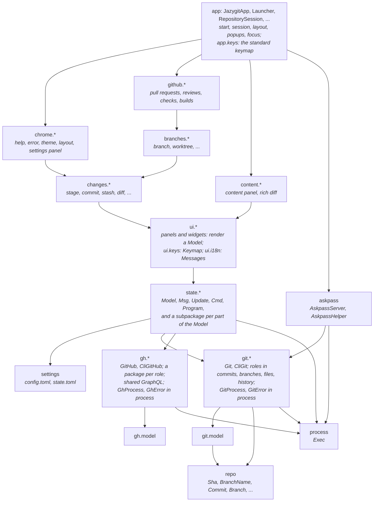
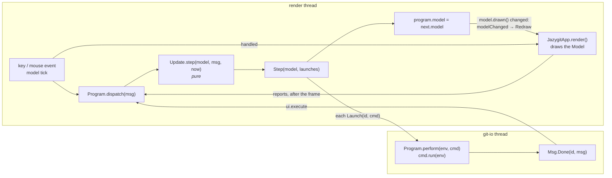
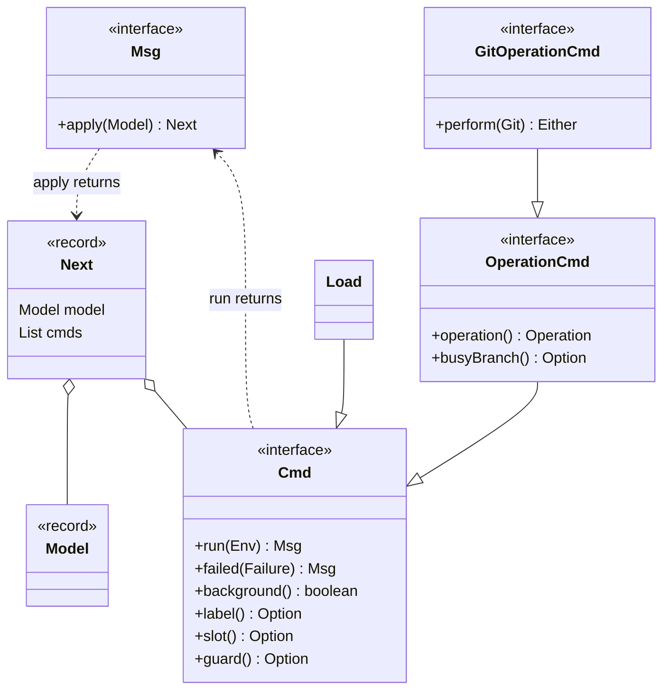
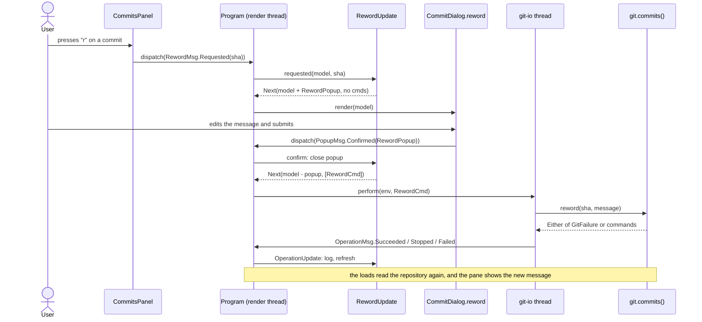

# jazygit architecture

jazygit is a lazygit-style terminal UI for git, built on [TamboUI](https://github.com/tamboui).
It follows the **Elm architecture**:

- The whole UI state is one immutable `Model`.
- Every event (a key press, a tick, a git result) is a `Msg`.
- A pure update function turns `(Model, Msg)` into the next `Model` plus the IO to perform, as `Cmd`
  values.
- Commands run against git (and, for GitHub, `gh`) on a background thread, and their outcome comes back as a
  new `Msg`.

Rendering never talks to git, and update functions never do IO.

This file is a map of the shape of the code: the modules, the layers, the loop and what a feature is made of. It
does not describe features; the code, its Javadoc and the tests do. Why things are as they are is in the ADRs, in
`documentation/adr`. Change this file only when the shape changes.

## Modules

The modules are in four groups, a folder each whose pom is the parent of its modules, and a module's name starts with
its group's (ADR 159). A group uses the groups above it in this table, never one below it, as `GroupsTest` in the app
checks: the build only stops cycles. The packages below are
named from under their group's: `state.*` is `net.vanfleteren.jazygit.kernel.state`, `git.model` is
`net.vanfleteren.jazygit.core.git.model`, `repo` is `net.vanfleteren.jazygit.core.repo`.

| Module | Holds | Depends on |
|---|---|---|
| `jazygit-lib` | The libraries: values and formats that know nothing of git, GitHub or the application. | |
| ↳ `lib-base` | `base`: `Require`, the guard against a call that breaks what a method needs; a tool any part may use. | |
| ↳ `lib-lens` | `lens`: `Lens`, where a value sits in another; a tool any part may use. | vavr |
| ↳ `lib-json` | `json`: JSON as plain values, and decoders into records (ADR 42). | vavr, Parsson |
| ↳ `lib-yaml` | `yaml`: YAML as it is written, to be drawn (ADR 123). | vavr, SnakeYAML Engine |
| ↳ `lib-xml` | `xml`: XML as it is written, to be drawn (ADR 151). | vavr |
| ↳ `lib-syntax` | `syntax`: the lexer that finds the tokens of a line of code (ADR 53, 113). | vavr |
| ↳ `lib-image` | `image`: PNG and GIF decoded into a `Picture`, without AWT (ADR 84). | vavr |
| `jazygit-core` | The core: running git, gh and ssh, and what they report as values. | lib |
| ↳ `core-process` | `process`: running a program, and what it did as a value (`Exec`, `ExecutedCommand`). | vavr, zt-exec |
| ↳ `core-repo` | `repo`: what a repository is made of, as values that git and gh share: `Sha`, `BranchName`, `Commit`, `Branch`, `Upstream`, `Tag`, `Stash` (ADR 165). | vavr |
| ↳ `core-git` | `git`, `git.model`: running git, and what it reports as values, as diffs, blame and the status. | repo, base, process, syntax |
| ↳ `core-gh` | `gh`, `gh.model`: running gh, and what GitHub reports as values. | process, repo, json |
| ↳ `core-forgejo` | `forgejo`: asking Forgejo's HTTP API with fj's token, and what it reports as values: a commit's combined status, which hosts are Forgejo (ADR 174). | repo, json |
| ↳ `core-askpass` | `askpass`: lets ssh ask the user through jazygit: the socket, the helper ssh runs, its launcher (ADR 150). | process, git |
| `jazygit-kernel` | The kernel: what every feature builds on. | lib, core |
| ↳ `kernel-settings` | `settings`: `config.toml` and `state.toml`, the only part that reads or writes TOML. | lens, night-config |
| ↳ `kernel-state` | `state.*`: the `Model`, `Msg`, `Update`, `Cmd`, `Program`, a subpackage per part of the model, and `Part`, a part a feature keeps itself. | lens, image, settings, git, json, yaml, xml |
| ↳ `kernel-ui` | `ui.*`: the panels and widgets that draw a `Model`; `ui.keys` (`Keymap`, `Scopes`), `ui.i18n` (`Messages`), `ui.content` (`Body`, what a kind of content is; `ContentSource`, what shows it), `ui.settings` (`SettingsSection`, a section of the settings panel), and `Feature`, `FeatureAction` in the shell. | base, state, TamboUI, commonmark |
| ↳ `kernel-content` | `content.*`: the content panel and, in `content.diff`, the rich diff; only the app uses them. | ui, syntax |
| `jazygit-features` | The groups of features, a module each, with this pom as their parent (ADR 136): | kernel |
| ↳ `features-changes` | `changes.*`: stage, files, discard, commit, ahead, cherrypick, stash, edit, copy, diff, fetch, inprogress; `changes.panes.commits` and `changes.panes.stash`, the commits and stash panes (ADR 158). | ui |
| ↳ `features-branches` | `branches.*`: branch, worktree, forcedelete, repos, start. | changes |
| ↳ `features-github` | `github.*`: pull requests, reviews, checks, builds, and how gh runs in the settings panel; the only module of the application that names gh. Deleting it, with `core-gh`, leaves jazygit working, without GitHub (ADR 171). | branches, changes, gh |
| ↳ `features-forgejo` | `forgejo.*`: how the last build of each branch on Forgejo went, as a badge in the branches pane (ADR 174); the only module of the application that names `core-forgejo`. Deleting it, with `core-forgejo`, leaves jazygit working, without Forgejo. | forgejo |
| ↳ `features-chrome` | `chrome.*`: help, error, theme, layout, the settings panel. | changes |
| ↳ `features-agent` | `agent.*`: handing a failed build to a coding agent (ADR 161); it knows no forge, and reaches the build only through the keys a forge's views host. | — |
| `jazygit-app` | `app.*`: `JazygitApp`, `Launcher`, `RepositorySession`, `Popups`; `app.cli`; `app.keys` (`GlobalKeys`, `Standard`, `StandardContent`, `Features`). Builds the fat jar and the native image. | the groups of features, content, askpass, TamboUI's backend, picocli |
| `jazygit-github-app-tests` | Tests only: the tests of the whole app with GitHub in it, run against the app's test-jar, so that the app's own tests pass without GitHub (ADR 171). | app, github |
| `jazygit-test-support` | What the architecture tests share (`CoreRules`, `ModelRules`, `AppRules`) and the bundle checks (`Bundles`). Test scope only. | ArchUnit |
| `jazygit-benchmarks` | JMH benchmarks, only built with `-Pbench`. | git, ui, JMH |

Each module has one root package, `net.vanfleteren.jazygit.<group>.<name>` after its name `<group>-<name>`
(`features-github`, `net.vanfleteren.jazygit.features.github`); the app's is `net.vanfleteren.jazygit.app`. The
libraries and the core (`jazygit-lib`, `jazygit-core`) cannot see the application, TamboUI, picocli or night-config,
and git and gh cannot see each other; nor can a module of the application see one above it, nor a group of features
one beside it. The compiler stops any such dependency. The rules inside the modules (the models are pure, failures
are values, updates are functions) are ArchUnit tests: `CoreRules` and `ModelRules` for the core, `AppRules` for the
application, run by each module's `*ArchitectureTest` on its own classes.

Each module of the application that has text has its own bundle, in its root package
(`net/vanfleteren/jazygit/features/github/messages.properties`), and its keys start with its name without the group
(`github.dialog.…`); `Messages` looks a key up in the bundle its first part names, in the kernel, the features or the
app, and otherwise in the bundle of the views, whose keys have no prefix.

## Packages

Each box is a module (the core's modules hold a few); the arrows are its dependencies, and what is below a module
it reaches through them. `lens` and `image` are below `settings` and `state`, and left out.

- **Inside a module the parts have no cycles either**: the features of a group (`ChangesArchitectureTest`, ...), the
  subpackages of `state` (`diff`, `view`, `load`, `operation`, `popup`, `index`, `preferences`;
  `state` itself uses them all, and they all use it, as the `Model` holds them), and those of `ui`.
- **The subpackages of `ui` follow the panes**: the shell (`ui` itself: `LeftColumn`, the status and command log
  panels, `Feature`, `LeftPane`) → the panes (`branches`, `commits`: the rows of commits, `files`,
  `github`) → `markdown`, `widgets`, `edit` → `content`, `keys`, `text`, `theme`, `i18n`. The content panel, which
  uses the panes, and the rich diff are `kernel-content`, beside the features: no feature draws them. Nothing in
  them uses the shell (`UiArchitectureTest`).
- **Each kind of content draws itself**: what an area of the content panel shows is a `ui.content.Body`, an open
  interface: it draws itself and says what sets it apart (drawn to the width of its area, its keys, its clicks). It is
  in `ui`, below the panes, so a group of features can add a kind of its own; nothing in `kernel-content` but a body
  asks which kind of body a value is (`ContentArchitectureTest`).
- **What the content panel shows comes from sources**: a `ui.content.ContentSource` says what it shows next to a pane,
  if it is its to show, and declares the areas it shows it in. `ContentView` asks the sources of the features, in the
  order of `Features.ALL`, then the content panel's own (`PanelSources`), and shows what the first that answers gives
  (ADR 154). The app gives them as a service, `ContentSources.standard()`, as it gives the keymap, and hands them
  to the `ContentPanel` it builds; a test hands it its own.
- **A kind of content keeps its own keys, scroll value and focus**: a body can handle keys of its own, content that is
  no diff is a `ScrolledContent.Other` of its source, and an area says what is opened in it, which takes the focus from
  its pane (ADR 155). Nothing in `kernel-content` asks which kind of `Other` a value is (`ContentArchitectureTest`).
- **A feature keeps its content in a `content` package**: what a feature shows in the content panel, its source, body
  and text, is in a `content` package of the feature, as the builds of a branch in `github.builds.content` (ADR 156).
  The rules take its classes for views, as they take the dialogs.
- **A feature keeps its part of the model**: what a feature keeps in the model beyond a popup is a value under a
  `state.Part` it declares in its own package, as the builds of a branch under `BuildsView.PART`; the `Model` holds
  them in `parts` by the part's name, without naming them (ADR 157), and `PartNamesTest` checks that no two parts
  share a name. What the panes and several features read stays a field of the `Model`.
- **A feature's code lives in its feature's module** (ADR 158): where the kernel names a feature, that place becomes
  an extension point the feature fills, once it moves. A `Part` declares what the kernel asks of it: queries
  (`rereading`, `knowingCommits`, `stating` what the branches are built on, `naming` the repository on the host of
  the remotes) and one `reacting` to a `KernelEvent`, asked only of the parts that are kept, in the order of their
  names. `Targeted` and `LoadMsg.Read` are open, and `Target.inPart` keeps what a feature's load
  reads in its part. A pane lives in the group that owns most of what it shows, in its `panes` package, as
  `changes.panes.commits`; the app gives it to `LeftColumn` as a `LeftPane`, and its id is a `PaneId` constant. The
  search of the commits is the first that moved.
- **A pane declares keys the features fill** (ADR 172): a pane in a group names no feature; it declares `PaneKey`s
  beside itself, as `CommitsPane.LINE` and `CommitsPane.LISTING`, which a `Feature` fills with `filling`, and the app
  gives it the `Fills` of its features (`Features.FILLS`). For each key, the first feature that gives anything wins.
- **The kernel names no forge** (ADR 167, 169, 171): GitHub's state, its stores, its screen, its stack and its
  review threads are `features-github`'s. The kernel composes what the features state the branches are built on
  (`BranchBases`, from each part's `StatedBases`), tells the reactions which commands started (`Reaction.started`, as
  a read of GitHub gets its id then), and holds what a feature runs against of its own in the `Env` under an
  `Env.Service` the feature declares, as its stores. A notice of a feature is one of its own sealed set, saying itself
  as a phrase (`Notice.Phrased`), as its errors do (`Failure.Phrased`). `AppRules.theKernelNamesNoForge` keeps
  `kernel..` from `core.gh..` and `features.github..`, without exception.
- **Remarks are the kernel's** (ADR 171): the rich diff draws `RemarkThread`s of `Remark`s, on a `DiffSide`, which a
  part states for the changes open through `Part.remarking` (`StatedRemarks`); GitHub's `github.remarks` part reads
  the review threads of a pull request when its files open (`KernelEvent.ChangesOpened`) and states them. The keys of
  a diff with remarks are on `Scopes.REMARKED_DIFF`, which the feature that states them binds.
- **A feature is on or off for a repository** (ADR 171): besides its actions, content and settings, a `Feature`
  declares what it builds to run against when a repository opens (`running`, a `Contribution` of services to the
  `Env`), its spinners and clocks (`spinning`, `clocking`), and whether it applies (`applying`, a detection run when
  the repository opens). `Feature.gated` keeps what a feature that is off would show or run out (`Model.on`,
  `FeatureSwitches`; keys through `Keymap.owned`, screens through `Screen.feature`, legends through
  `Legend.feature`), but for its section of the settings panel. A forge's detection tells which remotes are its own
  (`FeatureMsg.Claimed`, a `ForgeClaim`); once every forge told, the kernel switches on the forge of the home of the
  pull requests, or asks the user which it is (`kernel.state.forge`: `ForgeDecision`, `ForgeUpdate`,
  `ForgeChoicePopup`, kept in git's `jazygit.forgeHome`), and keeps the home in the model (`ForgeHome.of`) (ADR 177).
  GitHub reads its pull requests once it is switched on (`KernelEvent.Switched`).
- **Each forge has its own pull-request dialogs, and binds the keys the other does** (ADR 175): features that are on
  or off may bind one key in a scope, once each; it sends a `FeatureMsg.FirstOn`, which runs what the first of them
  that is on sends, and the help lists it once.
- **The views find the app's keymap without naming it**: `Keymap.standard()` is the `Keymap.Source` the app gives as a
  service (`META-INF/services`); without the app, as in the tests of `ui`, it is empty.
- **Views use `ui` only to draw.** Nothing in `ui`, `app.keys`, a dialog or a feature's content runs git or gh.
  `ui.text.ErrorText` is the only place that turns errors into text.
- **Only views use `ui.i18n` and TamboUI**: `ui`, `app.keys`, the dialogs and the content of the features and the
  app itself.

## The runtime loop

`Program` holds the current `Model`. `RepositorySession` gives it three executors:

- **ui**: the TamboUI render thread. It is the only thread that reads or replaces the model.
- **io**: a single `git-io` thread, so the commands the user asks for never run concurrently.
- **background**: a `git-fetch` thread for slow commands nobody waits for (`Cmd.background()`), like the fetch.
  Commands that write remote-tracking refs or `FETCH_HEAD` name a `Cmd.guard()`, so they run one after the other
  wherever they run (ADR 27).

Every command answers with a `Msg`, also one that throws: `Program.perform` turns that into a `Failure.Bug`.

- **A frame is drawn only when asked for** (ADR 14): after an event that is handled, when `Model.drawn()` changed, or
  through `JazygitApp.requestRedraw()` for what the model does not see. Anything that changes the screen without
  either must ask for a frame itself.
- **The view reports back.** Cursors and focus live in the widgets (ADR 2). After each frame,
  `JazygitApp.reports` compares the widgets with the model and dispatches what differs (`SelectionMsg`,
  `ViewMsg.Focused`). This is the only way the view tells the model something no user event did.
- **What runs is in the model.** `Update.step` stamps each command with an id into `Jobs.running`; `Msg.Done`
  takes it out (ADR 39). Busy branches, running loads and the activity line all derive from that.
- **The repository is read on ticks**, guarded by stamps of git's files so an idle app runs almost no git
  (ADR 15, 58, 67, 93).

## Core types

- **`Msg` applies itself.** Each feature has a sealed sub-interface (`RewordMsg`) whose `apply` delegates to that
  feature's update class (`RewordUpdate`), so adding a feature changes neither `Update` nor `Msg`.
- **`Cmd` is immutable data** that runs itself against an `Env` (the `Git`, the stores, and what the features run
  against of their own, each under its `Env.Service`, as GitHub's `GitHub`) and folds the `Either`
  it gets into a `Msg`, a failure through `failed(Failure)`.
- **`Load`** reads part of the repository into the model as a `Loadable` (`Loading`, `Loaded`, `Failed`).
- **`OperationCmd`** changes the repository. Its outcome is `OperationMsg.Succeeded`, `Stopped` (on conflicts) or
  `Failed`, which `OperationUpdate` handles alike for every operation: log the commands, free the branch, store the
  error or notice, read the repository again (`RereadUpdate.refresh`, which a tick reads through too). Its `start`
  refuses one that waits while the repository is in the middle of something; `PopupUpdate.ask` opens the popup about
  one, and `PopupUpdate.confirm` starts what was entered in it. A `GitOperationCmd` needs only `perform(Git)`.
- **Errors are data until the view.** An `AppError` says itself as a `Phrase` (a message key and its arguments);
  `ErrorText` turns it into text. Each feature keeps its own sealed `XxxError`.
- **Popups, and what is typed in them, are part of the model** (ADR 2, 38). `model.popup()` says which dialog is
  open; Escape and Enter go through `PopupMsg.Dismissed` and `PopupMsg.Confirmed` unless a feature needs more.
- **Cursors and focus are view state** (ADR 2): they live in TamboUI, and the model learns what they point at from
  the reports above.

### The anatomy of a feature

Each feature package follows the same shape:

| Type | Example (reword) | Role |
|---|---|---|
| `XxxMsg` | `RewordMsg` | Sealed set of the feature's messages. |
| `XxxUpdate` | `RewordUpdate` | Pure transitions for those messages. |
| `XxxCmd` | `RewordCmd` | The IO the feature asks for, usually an `OperationCmd` with its `Operation`. |
| `XxxPopup` | `RewordPopup` | What the open dialog is about; it lives in the model. |
| `XxxView` | `BuildsView` | What the feature keeps in the model beyond a popup, if anything, as a `Part` it declares (`BuildsView.PART`). |
| `XxxDialogs` | `CommitDialog.reword` | The dialogs, mostly as data (`ConfirmDialog.Spec`, ...), as `PopupSlot`s. |
| `XxxKeys` / `XxxAction` | `DropAction` | The keys, added to the immutable `Keymap`; an action bundles one operation's keys and popups. |
| `XxxFeature` | `CommitFeature` | Its `FEATURE`, a `Feature` of the feature's actions, of what it shows in the content panel, if anything (`ContentSource`), and of its settings, if any: the `SettingKey`s it keeps in `config.toml` and the `SettingsSection`s it adds to the settings panel (ADR 163). What `Keymap`, `Popups`, the content panel and the settings panel know of it. |

A feature lives in the group of features it belongs to, and is wired in by one line in `Features.ALL`, whose order is
the order of the keys in a panel; nothing else outside its package names it (ADR 127). Its text is in its group's
bundle, under keys that start with the group's root. The larger features (commit, branch, github, worktree) give each
operation a subpackage holding all of the above; adding an operation is adding its subpackage and one line in the
`XxxFeature`.

## The git and GitHub layers

- **Everything goes through the command line**, `git` and `gh`, so the repository is read and changed exactly as git
  does, with its configuration, hooks and credentials.
- **Roles** (ADR 69, 114): `Git` and `GitHub` are records holding one interface per role (`Stashes`, `Branches`,
  `PullRequests`, `Reviews`, ...), each implemented by a `Cli*` class. The roles live in subpackages that depend one
  way (ADR 120): gh has a package per role over `gh.graphql` and `gh.process`; git groups its roles in
  `git.commits`, `git.branches`, `git.files` and `git.history` over `git.process`, because its `Cli*` classes call
  each other across roles. What crosses a package is public; ArchUnit keeps the app to `CliGit`, `CliGitHub`, the
  roles and the errors. Tests replace the roles they
  need on `StubGit.of()` and `StubGitHub.of()`.
- **One place starts a process:** `GitProcess` and `GhProcess`, both through `process.Exec`. A command is data
  (arguments, environment, timeout) and never prompts: no terminal credentials, no editor, ssh in batch mode. Only
  for what the user starts, ssh asks through the app: it runs jazygit as its `SSH_ASKPASS`, which passes the question
  to the running app over a socket (`core-askpass`); the popup that asks is the app's (`app.askpass`, ADR 150).
- **gh's JSON** is decoded with the `Decoder`s of `lib-json` (ADR 42), one query class per read.
- **Errors as values.** Nothing throws on purpose. A read returns `Either<GitError, T>`; a write returns
  `Either<GitFailure, List<ExecutedCommand>>`, the failure carrying the commands that ran (ADR 75). Parsers return
  `Either` too. `Unfinished.runOrUndo` leaves a merge or rebase stopped on conflicts for the user, and undoes one that
  stopped half-way otherwise.

## Example: rewording a commit

## Testing

- **The tests go with their module**, but for those that need what it cannot see (a feature's messages or text, the
  app's keymap): those are in `jazygit-app`, in the package of what they test, and those of them that need GitHub in
  `jazygit-github-app-tests`, as `XxxGitHubTest` beside the app's `XxxTest`. `kernel-state`, `kernel-ui`,
  `features-branches`, `features-github` and the app share their test helpers as test-jars.
- **Without a forge**: `ForgesDeletableTest` checks that nothing but a forge's modules (`features-github`, `core-gh`
  and `jazygit-github-app-tests`; `features-forgejo` and `core-forgejo`) and one line of `Features.ALL` names it, in
  the classes and the poms, and the app's own tests run without the forges (`jazygit.without`), so that deleting one
  leaves an app that works (ADR 171, 173, 174).
- **Update functions** are pure: build a `Model` (`TestModels`), apply a `Msg`, assert on the next model and its
  commands. No git involved.
- **`ProgramTest`** runs the real loop with queue executors and `StubGit`.
- **The git layer** is tested against real temporary repositories; its parsers on fixed git output.
- **UI tests** use TamboUI's `ToolkitTestRunner` and its pilot, and assert on the rendered screen.
- **Acceptance tests** (`acceptance/`, Python) run the built jar in a pseudo terminal and check the repository with
  git; see [acceptance/README.md](acceptance/README.md).
- **Each module's `*ArchitectureTest`** enforces the rules above, and its `*BundleTest` that its bundle holds the keys
  its code names.
