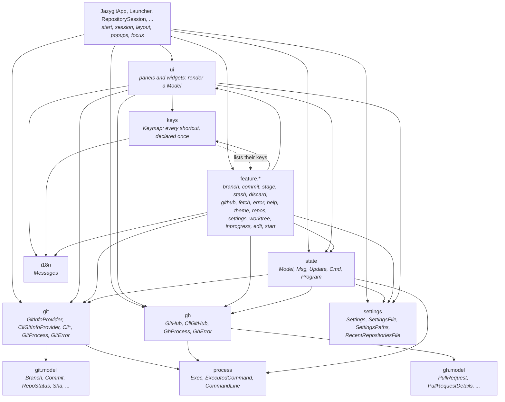
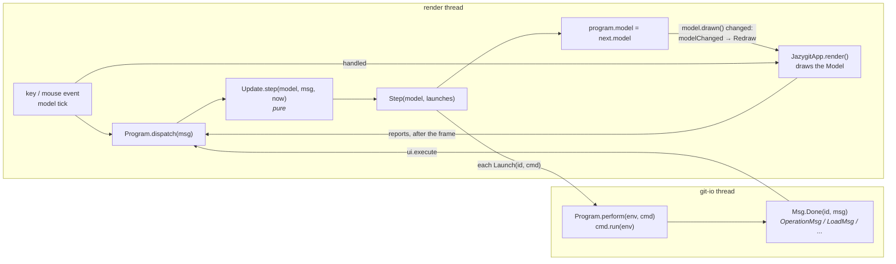
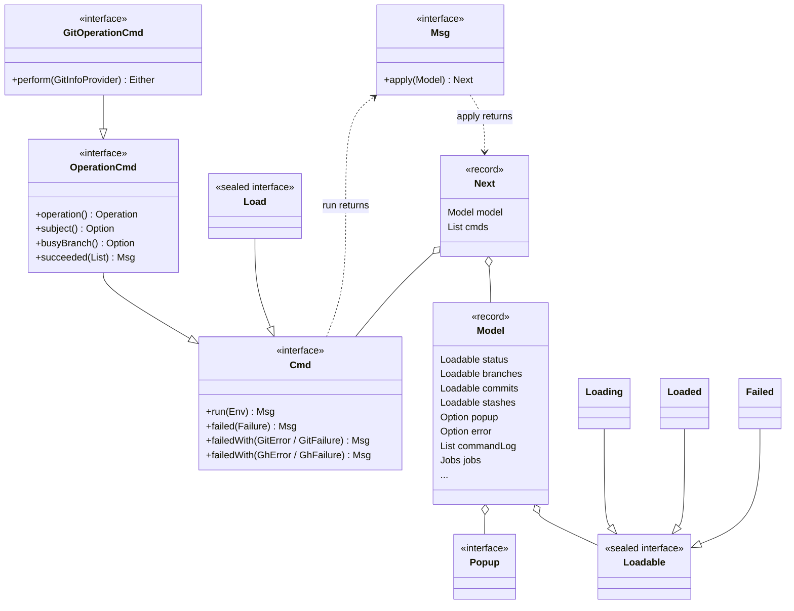
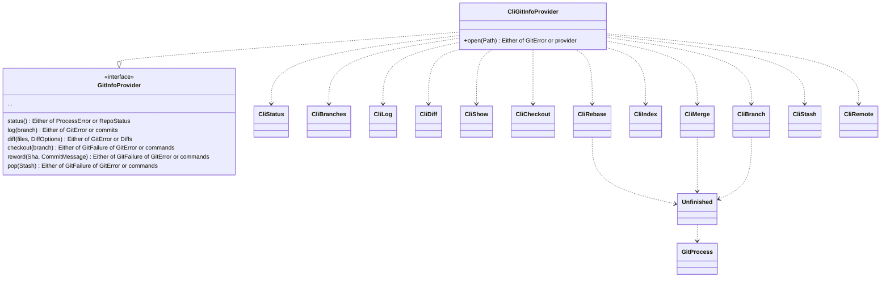
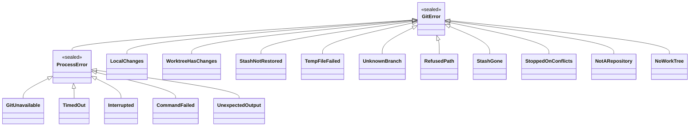
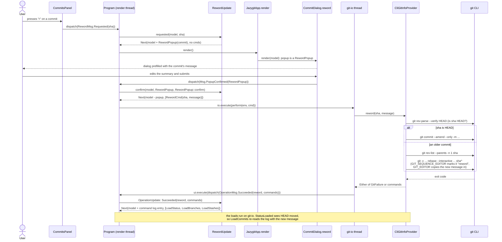
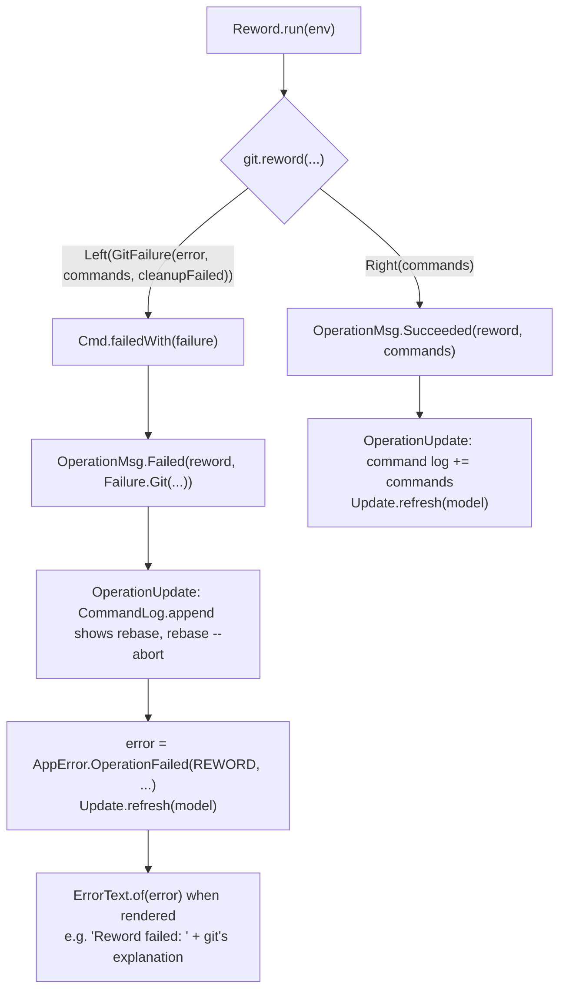

# jazygit architecture

jazygit is a lazygit-style terminal UI for git, built on [TamboUI](https://github.com/tamboui).
It follows the **Elm architecture**:

- The whole UI state is one immutable `Model`.
- Every event (a key press, a tick, a git result) is a `Msg`.
- A pure update function turns `(Model, Msg)` into the next `Model` plus the IO to perform, as `Cmd`
  values.
- Commands run against git (and, for GitHub, `gh`) on a background thread, and their outcome comes back as a
  new `Msg`.

Rendering never talks to git, and update functions never do IO.

## Modules

The Maven build has three modules under the parent `pom.xml`, and a fourth with `-Pbench`:

| Module | Holds | Depends on |
|---|---|---|
| `jazygit-json` | `json`: JSON as plain values (`Json`), and the decoders that turn it into records (`Decoder`), ADR 42. | vavr, Parsson's streaming parser |
| `jazygit-core` | `process`, `git`, `git.model`, `gh`, `gh.model`: running git and gh, and what they report as values. | `jazygit-json`, vavr, zt-exec |
| `jazygit-app` | Everything else: `JazygitApp`, `cli`, `state`, `feature.*`, `ui`, `keys`, `settings`, `i18n`, and all resources. Builds the fat jar and the native image. | `jazygit-core`, TamboUI, picocli, night-config |
| `jazygit-benchmarks` | JMH benchmarks of pure parts of the core: `WordDiffBenchmark` times parsing a diff and comparing the words of its changed lines, for the rich view (ADR 44). Only built with `-Pbench`, so no part of `verify` or CI. | `jazygit-core`, JMH |

The packages keep their names (`net.vanfleteren.jazygit.git`, ...), whichever module they are in. The core
cannot see the application, TamboUI, picocli or night-config, so the compiler stops it from depending on them.
The rules inside the core (git and gh know nothing of each other, the models are pure) are in
`CoreArchitectureTest`. The core's test-jar shares `StubGitProvider`, `StubGitHub` and `SampleData` with the
app's tests. `jazygit-json` knows nothing of jazygit; only its `JsonReader` uses Parsson, and the core and the app
do not use it at all (`JsonArchitectureTest`, `CoreArchitectureTest`, `ArchitectureTest`).

`mvn verify` at the root builds and tests all three. `./run.sh` runs the fat jar from `jazygit-app/target`, and
`mvn -Pnative package` builds `jazygit-app/target/jazygit`.

## Packages



The arrows are the dependencies allowed. Inside `jazygit-app`, `ArchitectureTest` fails on any other;
inside `jazygit-core`, `CoreArchitectureTest` does; and the core cannot reach the app's packages at all.

- **The parts have no cycles**, with one exception: `Keymap.standard()` lists the keys of the features, which
  declare them with the types of `keys` (dotted).
- **Views use `ui`, but only to draw:**
  - The dialogs of a feature use the widgets of `ui`.
  - `ui` uses `git` and `gh` only for the errors, which `ErrorText` describes.
  - Nothing in `ui`, `keys` or a dialog runs git or gh.
- **`git` and `gh` know nothing of each other**, nor of anything above them: they live in `jazygit-core`.
- **Only views use `i18n`.** `state` does not.
- **`settings` knows nothing of the application**, and is the only part that reads or writes TOML.

| Package | Responsibility |
|---|---|
| `JazygitApp` | Lays out the panes and the content, shows the open popup and routes the keys and the mouse to the model. Next to it: `Launcher` reads the command line and opens the repository; `RepositorySession` runs the `Program` and its threads, and opens another repository in its place; `TerminalHandOver` sets the terminal up and hands it to an editor; `Timers` dispatches what happens every so often; `Popups` lists the popups of the features; `FocusKeeper` keeps where the focus is; `ui.LeftColumn` lays out the panes of the screen shown. |
| `ui` | Panels (`FilesPanel`, `BranchesPanel`, `CommitsPanel`, `ContentPanel`, `CommandLogPanel`, ...) that render a `Model` and turn key events into `Msg`s; the dialog widgets (`ConfirmDialog`, `ChoiceDialog`, `TextInputDialog`, `PickDialog`) and the `DialogFrame` they are drawn in, with `WithDetails` for a box of details under one; `ErrorText`, the only place that turns errors into text. |
| `keys` | `Keymap`: the keys of each panel (`Scope`) and the global keys. Panels react to keys from it, and the help popup lists them from it. |
| `feature.*` | One package per feature. Each one holds the feature's messages, its update functions, its commands, and its popups, dialogs and keys. |
| `state` | The Elm core: `Model`, `Msg`, `Update`, `Cmd`, `Program`, `Loadable`, `Preview`, the parts the `Model` is grouped in (`Repo`, `RepoView`, `GitHubState`, `Jobs`, `Outcome`, `Preferences`), the operations (`OperationCmd`, `OperationMsg`, `OperationUpdate`), the periodic reads (`LoadUpdate`, `PullRequestsUpdate`), the highlights of the panes and the previews read for them (`SelectionMsg`, `SelectionUpdate`), the command log and the errors as data (`AppError`, `Failure`). |
| `git` | Everything that touches the repository, all through the `git` command line. All results are `Either` values. |
| `git.model` | Immutable value types describing the repository. |
| `gh` | Everything that talks to GitHub, all through the `gh` command line. It knows nothing of `git`, and `git` knows nothing of it; the features combine them. |
| `gh.model` | Immutable value types describing GitHub: `PullRequest`, `PullRequestDetails`, `MergeMethod`, `GhAccount`, `GhLogin`. |
| `process` | `Exec`, the only place that starts a program, for `git` and `gh` alike, and its `ExecFailure`; `ExecutedCommand`, a command as it ran; `CommandLine`, how a command line is written. |
| `i18n` | `Messages`: the user-facing texts, from `messages.properties`. |
| `settings` | What the user keeps from one session to the next (`Settings`, `ThemeName`), where it is kept (`SettingsPaths`) and the TOML file it is kept in (`SettingsFile`, behind `SettingsStore`); the state jazygit keeps by itself, the recent repositories (`RecentRepositoriesFile`, behind `RecentRepositories`). |

## Settings

The settings live in `config.toml`, in the directory that is the standard for the OS:

- **Linux:** `$XDG_CONFIG_HOME/jazygit` if that is set to an absolute path, else `~/.config/jazygit`.
- **macOS:** `$XDG_CONFIG_HOME/jazygit` if that is set, else `~/Library/Application Support/jazygit`.
- **Windows:** `%APPDATA%\jazygit`.
- **`$JAZYGIT_CONFIG_DIR`** overrides the directory on all of them.

`main` loads them before the app starts, so the first frame is drawn in the right theme. A problem with the
file never stops the app:

- A missing file gives the defaults. The file is only made when a setting is first changed.
- A file that cannot be read, or a value that is not valid, gives the defaults, and the command log says so.
- Keys jazygit does not know are ignored.

A change in the app, like choosing a theme, updates the `Model` and returns a `Cmd.SaveSettings` with the
settings before and after. It writes only the settings that changed, so a hand edit made while jazygit runs
stays. Saving keeps the other keys, their order and their comments. It writes a temporary file and moves it
over the old one, and leaves a file that is not valid TOML alone. A symlinked `config.toml` stays a link: the
file it leads to is replaced and keeps its permissions. A `.lock` file beside `config.toml` and `state.toml`
themselves, not beside what a link leads to, is locked while they are read and written, so two jazygits do not
undo each other. It is kept, as a lock nobody can see is none. When the whole directory is the link (GNU Stow
does that when `~/.config/jazygit` does not exist yet), the lock is in the dotfiles repository after all: add
`config.toml.lock` and `state.toml.lock` to its `.gitignore`. When saving fails, the error is shown, and
the setting still holds until jazygit stops.

Ctrl+S shows the settings (`feature.settings`): the gh executable, the theme, and the GitHub account of the
repository. The keys in `config.toml` are `ui.theme`, `ui.diff-style` (which Ctrl+D switches, ADR 44) and
`github.executable`, the gh to run when it is not the one on the PATH; a new one is only kept once `<executable> --version` runs. Changing the gh executable or the
account shows the repository again through `Env.repositories()`, as switching to a recent repository does, so a
new `Env` runs gh as the settings say now.

## Recent repositories

The repositories opened last are state, not settings: jazygit writes them by itself, and they are not meant
to be edited. They live in `state.toml`, as `recent-repositories`: the roots of their working trees, the
last one opened first, at most 20. The unseen pull requests of each repository live there too, as
`unseen-pull-requests` (ADR 29); writing either keeps the other.

- **Linux:** `$XDG_STATE_HOME/jazygit` if that is set to an absolute path, else `~/.local/state/jazygit`.
- **macOS:** `$XDG_STATE_HOME/jazygit` if that is set, else `~/Library/Application Support/jazygit`.
- **Windows:** `%LOCALAPPDATA%\jazygit`.
- **`$JAZYGIT_STATE_DIR`** overrides the directory on all of them.

`main` records the repository it opens. Every change reads the file again first, so what another jazygit
recorded meanwhile stays. A file that cannot be read gives none, and is written anew; failing to write is not
shown, as the list is only a convenience.

Ctrl+R lists the others, leaving out the ones whose directory is gone, which are forgotten too. Choosing one
runs `RecentReposCmd.SwitchTo`, which asks `Env.repositories()` to open it. `RepositorySession` does that: it opens
the repository on the thread of the command and then, on the render thread, stops the runtime of the old one
without waiting for the git command that runs, and starts a new `Program` for the new one from scratch. The
theme and the settings of the session stay. A repository that cannot be opened is forgotten, and the error is
shown in the one still open.

## Starting outside a repository

When the start directory is in no repository, or does not exist, `Launcher` runs `StartApp` before `JazygitApp`
(`feature.start`, see `documentation/adr/0028-start-outside-a-repository.md`). It asks what to open instead:

- `i` makes the folder a repository with a plain `git init` (`CliGitInfoProvider.init`), unless it does not exist;
- `o` asks for the path of another folder, relative to the folder asked about, or from `~`. One inside a repository
  opens it; one outside any is asked about in turn; a path that names no folder is said under the input;
- `r` lists the recent repositories, when there are any;
- `q`, Escape and Ctrl+C quit, with exit code 0.

`StartApp` is Elm-like too, but small: its model is the app's `Model`, with no repository, so its dialogs are the
app's own. `StartMsg` updates it, and the `StartCmd`s it asks for run on a thread of their own; they need no `Env`,
as there is no repository yet. A repository that opens (`StartMsg.Opened`) ends it, with the working tree that
`main` then opens as it would have opened the start directory. The theme and the settings are loaded first, so it
is drawn as the app is.

## Worktrees

The worktrees of the repository are read with the other periodic loads, into `Model.worktrees`, and listed on the
third tab of the branches pane (`feature.worktree`). The one shown is marked, and so are the main one, a locked
one and one whose directory is gone.

- **Adding:** what a new worktree checks out is a `WorktreeSource`: an existing branch, a new branch, a revision on
  no branch, or a pull request. Each way of adding one asks for it, then where the worktree goes, next to the main
  worktree by default, as `<main>-<branch>`; a leading `~` is the home directory. Once added, the pane shows the
  worktrees and switching to the new one is offered.
  - `w` on a local branch checks it out (`git worktree add <path> <branch>`); `W` on a branch, local or remote, asks
    for a new branch made from it (`-b`).
  - `n` on the worktrees asks where to start, the checked out branch to begin with, then for a new branch, which
    may be left blank: the worktree then checks out the local branch typed, when no worktree has it, or else what was
    typed on no branch (`--detach`).
  - `w` on a pull request of the repository adds a worktree on no branch and has `gh pr checkout` run in it, so a
    pull request from a fork gets its branch as checking it out in place gives it; when gh fails, the worktree is
    removed again. The changes of the worktree shown stay there.
- **Switching:** space on a worktree opens it in place of the one shown, as switching to a recent repository
  does (`RecentReposCmd.SwitchTo`), which makes it a recent one too.
- **Removing:** `d` removes a worktree other than the main one and the one shown (`git worktree remove`), keeping
  its branch or deleting it locally too, once the worktree is gone (`RemoveWorktreeCmd.deleting`). When git refuses
  because it has changes (`GitError.WorktreeHasChanges`), removing it anyway (`--force`) is offered, still deleting
  the branch when that was chosen.
- **A branch checked out in another worktree** is marked `wt` in the list of branches (ADR 45). git checks a branch
  out in one worktree at a time, so what it would refuse is not run: checking the branch out offers to switch to
  that worktree instead, and fast-forwarding it or adding a worktree for it fail up front with an
  `AppError.CheckedOutElsewhere` that names the worktree. Deleting it offers to remove that worktree and then delete
  the branch locally, the same removal as above, besides deleting it on its remote; only when the worktree cannot be
  removed either and the branch is not on its remote does deleting it fail up front. The branch feature depends on
  the worktree feature for this, so the keys switching the tabs of the branches pane, the worktrees' too, are the
  branch feature's.

## The distance from the base

A local branch shows how many commits it has that its base does not, and how many of its base it does not have,
`⇡1 ⇣58`, the base being that of ADR 20: its parent, else the main branch, from `origin` when it is there.
A branch whose base is its upstream shows only `↑`/`↓`. Every read of the branches asks for `Cmd.LoadBaseDistance`,
which runs `GitInfoProvider.baseDistance` (`CliBaseDistance`: one `git config --get-regexp` for the parents, one
`for-each-ref` for the refs, then one `for-each-ref --format=%(ahead-behind:<base>)` per base) and keeps a
`BaseDistance` per branch in `Repo.baseDistance`. A read that fails, or one that has not come in yet, leaves the
counts read before. The title of the log of a branch takes both counts from there, once they are read against the
base its log was compared with and at the tip it was read from; until then, from the commits read. ADR 46
counted only those behind; the count of those ahead came later, from the same `%(ahead-behind:)`.

## Divergence

`u` on a local branch offers, besides resetting the checked out branch onto its upstream, to view how the
highlighted branch diverged (`feature.branch`, `UpstreamUpdate`):

- **From its upstream** (`v`): the branch it follows, `Upstream.branch`: the remote-tracking one, or the local one
  for an upstream in the repository itself.
- **From the base branch** (`b`): `origin/<main>`, else the local `<main>`, where `<main>` is the branch `Branch.isDefault`
  marks. The main branch itself has no base.

`Model.divergence` (`state.DivergenceView`) holds the two branches, the commits only on either of them, read with
`GitInfoProvider.divergence` (two `git log a ^b` of at most 300 commits each, and `rev-list --left-right --count` for
how many there are), and the preview of the highlighted one. While it is open, the branches pane lists it in place of
the local branches: the commits only on the other branch, then the ones only on the local branch, each under the
name of its branch. The highlight skips those names. The content panel shows the highlighted commit as the commits
pane does, in a scroll area of its own, so the two panes do not take each other's preview. Escape, or switching
tabs, closes it.

It is read again when either branch moves, as the periodic loads of the branches tell. When the branch is gone, it
closes; when the upstream is gone, or the base branch, it closes with the error that says so.

## The commits of a branch

Enter on a branch, local or remote, lists its commits in place of the branches (`feature.branch.commits`,
`ui.BranchCommitsList`), drawn by the same `CommitsPanel.rows` and `marked` as the commits pane: the commits on the
base dimmed, and with `b` only the others and the fork point. Enter on a commit moves the focus to its diff; Escape,
or switching tabs, goes back to the branches.

`RepoView.branchCommits` (`state.BranchCommitsView`) holds only the branch and the preview of the highlighted commit.
The commits are not held twice: while the list is open, the branch stays the one highlighted in the branches pane,
so its log is `RepoView.branchLog` and what is ahead `RepoView.branchAhead`, read and read again as for the
highlighted branch. A log read for another branch shows as loading. When the branch is gone, the list closes. The
content panel shows the highlighted commit as the commits pane does, in a scroll area of its own. See ADR 23.

## Searching the commits

`/` in the commits pane opens a line above the list to type a query in (`RepoView.searchLine`); Enter runs it through
`GitInfoProvider.search`, and the pane then lists what it found in place of the log of HEAD (`RepoView.commitSearch`,
`state.CommitSearch`), flat, without the rails of merges, until Escape clears it. Its messages and update are in
`state` (`CommitSearchMsg`, `CommitSearchUpdate`), as the pane sends them; `feature.commit.search` only declares the
key. `git.model.CommitQuery` parses the query: bare words for the message, `author:`, `path:` and `-S:`, smart case.
See ADR 4.

The search runs again each time the log is read again, so it stays right after an operation, and the commit
operations find the commits it found through `Model.commit`, also those older than the log reads.

## The commits not on the base

The commits pane and the log of the highlighted branch dim the commits that are on the base of their branch: the
branch it was made from (`gh-merge-base`), else the main branch, `origin/` first. Their titles count the others.
`b`, in either pane, lists only those and the fork point (`RepoView.onlyAhead`), and a search then leaves the base
out. `Cmd.LoadAhead` reads it into `Repo.ahead` for HEAD and `RepoView.branchAhead` for the highlighted branch:
together with the log it goes with (`Cmd.LoadCommits`, `Cmd.LoadBranchLog`), so that a log is never shown undimmed
first, and on its own again when the base moves; `state.AheadUpdate` decides what to read, and
`ui.AheadView` how the panes show it. `feature.ahead` only declares the keys. See ADR 20.

## The pull requests screen

Ctrl+P switches the left of the screen between the repository and the pull requests (`Model.screen`, `state.Screen`);
the status panel names both, the one shown in bold. What the pull requests screen shows lives in one part of the
model, `Model.prOverview` (`state.prs.PrOverview`), with its own messages and its own update, which works on that part
alone (`PrOverviewMsg`, `PrOverviewUpdate`); only switching screens, and whether the screen is shown, look at the rest.
It lives in `state`, next to the other reads of GitHub, so the GitHub feature can read it again after changing a pull
request. The design and the steps still to come are in `prs.md`.

- The panes, top to bottom, are **This repo**, **Review requested** and **My PRs**. **Review requested** and
  **My PRs** list the open pull requests that ask for the user's review and the ones they opened, in any repository:
  one `gh api graphql` with two searches (`review-requested:@me`, `author:@me`), at most 50 each; the title says how
  many match when there are more. **This repo** lists the open pull requests of the repository, forks included, at
  most 100: another `gh api graphql`, apart from the read for the branches pane, which also tells which repository
  it is (`PrOverview.repositoryName`). The three share one fragment and one parser
  (`CliGitHub.parseLists`), with the checks of the last commit of each.
- They are read when the screen is shown, every minute while it is shown (`PrOverviewMsg.Tick`, from `Timers`),
  with `r`, and after a pull request was merged, closed or turned into a draft. Failing to read them again keeps the
  ones read; `PrOverview.freshness` keeps when they were last read and which read failed since, which the line at the
  bottom says on this screen ("read 2m ago · last read failed"). gh runs as the account of the repository, so the lists are that account's.
- **This repo** is also read while the screen is hidden: on the tick, and 3 seconds after a repository opens. The
  pull requests opened since, but not by the user, are unseen until their row is highlighted; the name of the screen
  counts them (`PRs ●2`) and their rows are marked (ADR 29). `PrOverview.unseen` holds them, with the highest number
  read, and `SaveUnseenPullRequests` keeps them in `state.toml`.
- `o` shows the pull request dialog, as for a branch, for a pull request of the repository, wherever it is listed;
  one of another repository opens in the browser, as `O` does for any (`gh pr view <url> --web`).
- **The preview**: the content panel shows the pull request highlighted in the pane in use like a commit: a header,
  its title and description, `---`, and its diff, read with `gh pr view <url> --json baseRefName,body` and
  `gh pr diff <url>`, so also for repositories that are not cloned; the diff is cut off after 5000 lines. It is read
  again when the pull request changed (`PrOverview.preview` is keyed by its summary), and the one shown before
  stays while it is read. Enter moves the focus into it, Escape back to the pane it shows.
- **Checking out**: space checks out a pull request of the repository in place, from a fork too, with
  `gh pr checkout <n>` (`CheckoutPullRequestCmd.CHECKOUT_PR`), which waits until the repository is in the middle of nothing. It is
  refused up front when the working tree has changes, untracked files apart (`AppError.ChangesBeforeCheckout`), and
  for a pull request of another repository (`AppError.OtherRepository`). Which repository this is is known once its
  pull requests were read; until then, checking out says they are still being read, or why they could not be.
- Each screen keeps where its focus was: `Msg.Focused` goes to `Model.focusedPane` or `PrOverview.focusedPane`,
  whichever screen is shown (`Model.shownPane`), and `FocusKeeper` gives it back when the screen is shown again.

## Diff options

How the diffs of the files and the commits are read is a `DiffOptions` (in `git.model`), which
`Preferences.diffOptions()` makes of what the user chose. It says whether changes to whitespace only are left out,
which Ctrl+W toggles anywhere outside a dialog (`feature.diff`) for the session only, and whether a merge is read
against its first parent, which the diff style decides (below); the context and side-by-side diffs are to follow it
there.

- `GitInfoProvider.diff` and `commitChanges` take the options, which `CliDiff.flags` turns into git's
  (`--ignore-all-space`). A file whose changes are all whitespace is then left out of the diff entirely, also from
  the files `git show --stat` lists.
- `Cmd.LoadFileDiff`, `Cmd.LoadCommitDetail` and `Cmd.LoadStashDetail` carry the options, and so do the messages
  they send back. They are the `Cmd.DiffLoad`s: what one of them read with other options than the model's, or
  failed to, arrives too late and is dropped by `LoadUpdate.update` in one place, as what was read for another
  highlighted item is.
- Toggling reads the diffs shown again (the files, the commit, the commit of a divergence and the commit of a
  branch's commits), which keep showing as they were until they are read.
- The titles of the diffs say when whitespace is ignored, and a diff that comes back blank says that only
  whitespace changed.
- The diff of a pull request is read with `gh pr diff`, which has no such option, so it shows all changes.

### The diff style and the files of a commit

See `documentation/adr/0044-a-nicer-commit-diff-with-a-file-tree.md` and
`documentation/adr/0047-the-rich-view-for-the-working-tree.md`.

- **The diff style** (`settings.DiffStyle`, kept as `ui.diff-style`) says how the diffs git reads are drawn: the
  staged and unstaged changes of the working tree, and the changes of a commit or a stash. `PLAIN` is git's text,
  `RICH` the rich view. Ctrl+D switches it (`DiffOptionsMsg.StyleToggled`), saves it and reads the diffs shown again,
  as Ctrl+W does: `RICH` reads a merge against its first parent (`DiffOptions.firstParent`,
  `--diff-merges=first-parent`), as the rich view does not draw git's combined diff of a merge. A path left
  unmerged by a conflict still shows as a combined diff (`diff --cc`) in the working tree: `UnifiedDiff` makes it a
  `CONFLICTED` file, whose lines are kept as git printed them. The staged and the unstaged areas are each a
  `Body.Diff` of their own, so each is parsed and its words compared on its own.
- **The rich view** is drawn by `ui.RichDiff` from `UnifiedDiff`, the diff parsed into files, hunks and numbered
  lines, and `WordDiff`, which pairs the removed and added lines of a block and finds the words that changed in a
  pair. Both are pure, in `git.model`. The content panel styles a body only when it changes, so a diff is parsed once
  each time it is shown again, not on every frame. A hunk starts with a dimmed rule in the gutter, not with git's
  `@@ -a,b +c,d @@` line, whose numbers the gutter shows already, nor the section heading git gives after them, a line
  from above the hunk that reads as one of its own. Only a header whose numbers cannot be read (`Hunk.numbered`) follows
  the rule as git printed it, as its lines have no numbers. The first hunk of a file has no rule otherwise: the bar of
  the file is right above it.
- **The files of a commit or a stash**, which `F` opens from the commits, divergence, branch commits and stash panes
  (`feature.diff.CommitFilesAction`), are a `CommitFilesView` in `RepoView.commitFiles`: whose changes they are, the
  pane they were opened from, the `CommitFile`s read (`Cmd.LoadCommitFiles`), and the diff of the highlighted node
  as a `Preview` (`Cmd.LoadCommitFileDiff`, a `DiffLoad` with a slot of its own). The files pane lists them in place
  of the working tree's (`ui.FileTreeList`, one per tree, so each keeps its own highlight and collapsed
  directories), and the content panel shows the diff in `ContentArea.COMMIT_FILE`. They open on the first directory
  that holds files directly (`FileTreeList.firstWithDiff`), whose diff shows something: the root only when files
  changed at the top of the repository.
- **Their focus:** `FocusKeeper` moves the focus into the files pane when they open, and back to the pane they were
  opened from when Escape closes them. `Model.withShownPane` closes them when another pane gets the focus, and
  `LoadUpdate` when the stash they are of is dropped.

## The editor

`e` on a file in the files pane opens it in git's editor (`feature.edit`): the one `git var GIT_EDITOR` names, so
`$GIT_EDITOR`, `core.editor`, `$VISUAL`, `$EDITOR`, else `vi`, as for a commit message. `CliEditor` runs it as git
does: the program itself when it is a plain name, else through `sh -c '<editor> "$@"'`, so `code --wait` works. It
is an `EditCmd.EDIT` like any other: the command log shows it, an editor that exits with an error is shown as a
failure, and the repository is read again once it is closed.

Ctrl+O in the commit and reword dialogs opens the message typed so far in the same editor (`MessageEditorMsg`,
`MessageEditorCmd`). `CliEditor.editMessage` writes it to a file named `COMMIT_EDITMSG` in a temporary directory, so
editors treat it as a commit message, and reads it back once the editor is closed. No comments are added to it, so
lines starting with `#` are kept. The message being typed lives in the popup (`MessagePopup.message`), so the
editor starts from it, and what comes back replaces it; the fields then show it, as they show any message the
model has. The dialog stays open meanwhile, and a failing editor
leaves it as it was.

The editor needs the terminal, which the TUI owns. `Env.terminal()` (`state.Terminal`) hands it over: `EditCmd`
and `MessageEditorCmd` run the editor inside `terminal().handOver(...)`, on the `git-io` thread. `TerminalHandOver`
implements it with `HandOverBackend`, the TamboUI backend the app gives the runner. It wraps the backend TamboUI picks
by itself (`BackendFactory.create()`, so `tamboui.backend` or `TAMBOUI_BACKEND` still chooses), and forwards to it:

- **Leaving**, on the render thread between two frames: it stops reading keys, then puts the terminal back as it
  was before the app started (no mouse capture or bracketed paste, cursor shown, main screen, cooked mode), and
  from then on drops what the app draws.
- **Meanwhile** the app keeps running, as it does not block the render thread: the model's ticks and the outcome
  of commands would otherwise pile up and be handled one by one afterwards. Loads and fetches carry on; what they
  draw is dropped. Coming back asks for a frame, as nothing else might draw one (see
  [When a frame is drawn](#when-a-frame-is-drawn)).
- **Coming back**, on the render thread again: it sets the terminal up as before, reads keys again, and clears
  TamboUI's buffers, so the next frame draws the whole screen.

While the terminal is handed over, a read waits out its timeout without touching the terminal; one under way is let
finish first. This takes a backend whose timed-out read leaves nothing behind, as the Panama backend, which polls the
terminal. The JLine backend does not do for this: after a read that timed out, it leaves a thread blocked on reading
the terminal, which would take the first key typed in the editor.

## The runtime loop

`Program` holds the current `Model`. `RepositorySession` gives it three executors:

- **ui**: the TamboUI render thread. It is the only thread that reads or replaces the model.
- **io**: a single `git-io` thread, so the commands the user asks for never run concurrently.
- **background**: a `git-fetch` thread for commands that are slow and that nobody waits for
  (`Cmd.background()`), so they don't hold up the others: the fetch, and reading the pull requests.
  - A fetch can run next to a command on `git-io`. git locks what it writes, so the two never corrupt the
    repository.
  - But `FETCH_HEAD` has no lock, and a ref that is locked makes the other command fail rather than wait. So a
    command that writes the remote-tracking refs or `FETCH_HEAD` (fetching, pulling, pushing, deleting a branch
    on its remote, checking out a pull request through gh) names a guard, `Cmd.guard()`. `Program` holds a lock
    per guard and takes it on the command's own thread around performing it, so such commands run one after the
    other, wherever they run. The background fetch also writes no `FETCH_HEAD`. See ADR 27.

Every command answers with a `Msg`, also one that throws. `Program.perform` turns whatever it throws into a
`Failure.Bug`, and writes the stack trace to `jazygit-bugs.log` in the temporary directory, as the terminal
belongs to the TUI. Without an answer, the command's load would keep running, or its branch would stay busy.

`--debug` writes a debug log, `debug.log` next to the state file, through SLF4J's simple logger, each line with
its date and time: every program `Exec` runs, reads as well as writes, with its arguments, directory, duration and
how it ended, the type of every message `Program` handles but the
clock's ticks, and the stack traces of the bugs. `DebugLog` sets the logger up before anything logs; without
`--debug` it logs nothing, so nothing reaches the TUI's terminal. The environment of a command is never logged,
as it can hold the gh token.

When the app stops, the commands still queued on `git-io` are dropped. The one that runs is not interrupted,
which would kill git half-way, say in the middle of a rebase. It gets two seconds to finish, and otherwise
finishes by itself once the app is gone.



### When a frame is drawn

TamboUI's own 40 ms tick is turned off (`noTick()`), so a frame is only drawn when something asks for one (see
`documentation/adr/0014-redraw-on-change.md`):

- **An event that is handled**, or a resize: TamboUI draws after those by itself.
- **A model that draws differently**: `Program` calls `modelChanged` when a message leaves a model whose
  `Model.drawn()` differs from the one before. `Model.drawn()` leaves out what only starts loads
  (`Jobs.readAt`, `Jobs.worktreeChangesRead`) and the commands that run (`Jobs.running`), but for the operations
  that keep a branch busy, whose spinner shows at once; and it takes the time to the second, so the periodic loads of an idle app draw nothing. This covers
  the outcome of commands, the model's ticks and the reports of the widgets.
- **`JazygitApp.requestRedraw()`**, for what the model does not see: a turning spinner (every 120 ms while
  `Spinners.shown`), a frame that moved the focus (`redrawIfFocusMoves`), a mouse press (a click on nothing clears
  the focus, which the next frame gives back to what had it), switching repositories and coming back from a
  handed-over terminal.

`modelChanged` calls `requestRedraw()` too. It dispatches a `Redraw` event, which a global handler handles, so
TamboUI draws a frame. At most one is queued (`redrawPending`), and a frame drawn for another reason meanwhile makes
it draw none: a burst of changes draws once. Anything that changes the screen without changing the model, or
without an event that is handled, must ask for a frame itself; nothing else draws it.

### The view reports back

The cursors and the focus are the widgets' (see [Core types](#core-types)), but the model needs to know what
they point at: the content panel shows the preview of the item highlighted in a pane, and a closing popup gives
the focus back to where it was. Whatever moved them (a key a list handles itself, a click, Tab, a list that
reselects after a reload, a popup that opens or closes), `JazygitApp.render` compares the widgets with the model
they were just rendered from, and makes the messages that tell it the difference (`JazygitApp.reports`):

- the item highlighted in each pane of the screen shown (`SelectionMsg`, `PrOverviewMsg.Highlighted`), from
  each panel's `selectionChange`;
- the element with the focus outside the popups (`Msg.Focused`).

They are dispatched once the frame is drawn (`TuiRunner.runLater`), never during a render, which draws one
model throughout. The next frame draws what they change, and reports nothing once the model agrees with the
widgets. A report can come twice, when a frame is drawn before the first one is dispatched, so each of them
leaves a model that already has its value as it is. This is the only way the view tells the model something
no message from a user's event did.

Every `jazygit.refreshInterval` (750 ms by default) a `Msg.Tick` triggers `Update.tick`, which re-reads the status,
and checks the files of the git directory that the local and remote branches (one load, `LoadBranches`), the stashes
and the worktrees are read from (`Cmd.CheckMetadata`). That check runs no git: it stamps the HEADs, the config,
`packed-refs`, the directories of the loose refs, the stash reflog and the worktrees' admin files (`GitMetadata`).
Only a load whose stamp differs from the one it was last started with (`Jobs.readAt`) runs again, so an idle app
runs one git process per tick instead of four. An operation that is done reads all of them at once
(`Update.refresh`), without waiting for the files to tell. That keeps the screen in sync with changes made outside
the app. A periodic load is skipped while an equal one is still running (`Jobs.runs`). See
`documentation/adr/0015-check-metadata-before-loading.md`.

A read that failed is tried again on a tick only once it waited 1, 2, 4… up to 64 ticks after each failure in a row
(`Jobs.retries`, `Jobs.retryDue`); `Update.refresh` tries it at once. The previews (a branch's log, a commit's or a
stash's changes, the files' diff) each take a slot, so highlighting faster than git answers only reads the last item;
a load cancelled that way reports `LoadMsg.Skipped`, and is done like any other command. See
`documentation/adr/0031-preview-slots-and-retry-backoff.md`.

Every message is handled at the time it is: `Program` hands it to `Update.step(model, msg, now)`, which sets
`Model.now` before the message is applied. `Msg.Clock` comes every second, apart from that, only to wake the model up
when nothing else happens, so the ages move on. The view rounds them: in minutes ("now" under one), and how long ago
the remotes were fetched, or the pull requests read, in steps of 10 s under a minute. `Model.drawn()` takes the time
to the second, so an idle app draws a frame a second. See `documentation/adr/0021-a-clock-apart-from-the-refresh.md`,
`documentation/adr/0022-fetched-ago-in-steps-of-10s.md` and `documentation/adr/0033-show-that-work-is-being-done.md`.

`Update.step` also stamps the commands the message asks for: each gets the next id (`Jobs.nextId`) and runs, in
`Jobs.running`, from that time on, until `Program` reports it done with `Msg.Done(id, result)`: what it reported, the
failure of a bug, or what a command that a newer one for its slot cancelled reports, if anything. `Msg.Done` takes it
out of `running` and applies what it carries. The handlers never see an id: they return `Next(model, cmds)`, and
`Program` only gets the stamped `Launch(id, cmd)`s of a `Step`. `Update.begin` stamps the first loads the same way.
With `--debug`, each command that is done is logged with how long it ran and what it reported.

`Jobs.running` is all the model knows of what runs (ADR 39): whether a load or a read of GitHub runs already is
`Jobs.runs(cmd)`, the branches an operation runs on are `Jobs.busy()`, from the `busyBranch()` of the
`OperationCmd`s that run, and a fetch runs while a `FetchCmd` does. As a message's commands only run once it is
handled, `Next` drops a command equal to one the same message asked for before.

The line under everything else (`ui.FetchLine`) shows what runs, on its right, before how fresh the screen is: a
spinner, the label of the command that ran longest of those that ran 300 ms (`Jobs.SHOWN_AFTER`), and how many more
did, like `Fetching origin +2`. A command says what it shows as with `Cmd.label()`, a message key with its arguments
(`Label`); an operation shows its command log title and what it is done to, and one without a label shows
`Working…`. When the last command that showed is done, `Msg.Done` keeps its label in `Jobs.lingering` for 300 ms more,
so the indicator does not blink out between two commands. Whether a command ran long enough is told by the clock the
frame is drawn at, so `Jobs.running` is not drawn (`Model.drawn()`); `Spinners.shown` draws frames while a command
runs or a label lingers. See `documentation/adr/0033-show-that-work-is-being-done.md`.

Every minute a `FetchMsg.Tick` fetches from the remotes in the background, unless the previous fetch is
still running. `FetchUpdate` lists the remotes (those `git fetch --all` would fetch) and fetches them one after
the other with `git fetch --prune <remote>`, so branches deleted on the remote show as gone, whatever
`fetch.prune` says. Each `FetchCmd.Fetch` carries the remotes still to fetch from after it, and its
message hands them back; the one that runs shows at the bottom of the screen as its label. When none are left, the
branches reload.
`Model.lastFetch` (a `Freshness`) holds when a remote was last fetched from, as `FetchCmd.Fetch` timed it, and the
remotes that failed the last time; the right of the line at the bottom says it, as "fetched 2m ago", with "last fetch
failed" when one did.
Neither the commands nor the failures are shown, since fetching also runs while offline, and a failing remote
doesn't stop the others. Once the fetch is done, the open pull requests are read again with `gh` (also once at
startup), into `Model.pullRequests`, which is none until they were read once. That read lives in `state` (`PullRequestsUpdate`, `LoadPullRequests`),
next to the other periodic reads, so the fetch does not depend on the GitHub feature. While it runs, the line
at the bottom says so, and another read does not start (`GitHubReads`); a failure there is
not shown either, as gh may be missing or logged out.

A change made on GitHub (creating, merging or closing a pull request) asks for a fetch at once, through
`FetchUpdate.requested`, so the branches show it without waiting for the next tick. When a fetch is already
running, it may have missed the change, so `Jobs.fetchAgain` makes another one follow it. The pull requests are
read again at once too, even when a read is running, as that one may have missed the change as well.

## Core types



- **`Msg` applies itself.** Each feature has a sealed sub-interface, for example `RewordMsg`, whose
  `apply` delegates to that feature's update class (`RewordUpdate`). Adding a feature therefore needs
  no change to `Update` or `Msg`. The one-line `apply` overrides, one per feature message interface, are
  the price of avoiding a central dispatch, and are kept on purpose.
- **A popup closes by itself (ADR 38).** Escape on a dialog sends `Msg.PopupDismissed(type)`, which closes
  the open popup if it is of that type. The specs of the dialog widgets send it by default; a feature declares a
  `Cancelled` message of its own, with `cancelledBy` on the spec, only when Escape does more than close. Likewise,
  a popup whose confirmation only starts its operation is a `ConfirmablePopup`: its `confirm()` makes the command,
  and Enter sends `Msg.PopupConfirmed(type)`, which `Spec.confirming(...)` sets up.
- **`Cmd` is immutable data** that knows how to run itself against an `Env` (the `GitInfoProvider` and the
  `GitHub`) and how to report failure:
  - `run` folds the provider's `Either` into a `Msg`.
  - `failed(Failure)` turns a failure into the failure `Msg`. A `Failure` is data: `Failure.Git` (the
    `GitError`, the commands that ran, and why the cleanup failed if it did), `Failure.GitHub` (the `GhError`
    and the commands that ran) or `Failure.Bug` (the command threw, which `Program.perform` catches).
- **`Cmd.Load`** reads part of the repository into the model, as a `Loadable`. Every `LoadMsg` names its
  load, so `LoadUpdate` knows which read came back or failed; `Msg.Done` has taken it out of what runs.
- **`OperationCmd`** changes the repository. It names its `Operation`, the branch it is done to, and the branch
  it keeps busy. An `Operation` is a record that the feature declares next to its commands (`DropCmd.DROP`,
  ...): the command log title, the error message, whether it waits until nothing is unfinished, and what a
  branch it keeps busy shows next to its spinner. Its outcome is an
  `OperationMsg.Succeeded`, `OperationMsg.Stopped` (it stopped on conflicts, left for the user) or
  `OperationMsg.Failed`, which `OperationUpdate` handles the same way for every operation: it logs the
  commands, releases the busy branch, stores an `AppError.OperationFailed`, a `Notice` or neither, and reads
  the repository again. A feature only adds its own messages for outcomes that really
  are special, like `CheckoutMsg.NeedsStash`; `OperationUpdate.succeeded` is what any success does, which
  such a message adds to. A `GitOperationCmd` is one done through git alone: it only implements
  `perform(GitInfoProvider)`. The others, like creating a pull request, implement `run(Env)` themselves.
- **Operations are started through `Update`.**
  - `Update.start` marks the operation's branch busy.
  - `Update.ask` opens the popup that asks about an operation, which clears the error of the last one.
  - `Update.confirm` closes that popup and starts the operation made of it.
  - A branch that is busy (`Model.idleBranch`) takes no other operation until it is done.
- **Errors are data until the view.** `Model.error` is an `Option<AppError>` and `Loadable.Failed` holds a
  `Failure`; `ErrorText` in `ui` turns them into text. `Model.fail` stores the error, which the command log
  shows, and opens an `ErrorPopup`, unless another popup is open, which then keeps what the user entered.
- **Popups are part of the model.** `model.popup()` says which dialog is open. `JazygitApp` renders the
  dialog that matches it and moves the focus into it, then back to the pane it came from once
  the popup closes. Each feature lists its dialogs, with the pane they give the focus back to, as
  `PopupSlot`s in `XxxDialogs.popups(dispatch)`; `Popups` only names the features.
  A popup that comes up by itself (`Model.openPopupIfFree`), like the outcome of a command or the theme key, does not replace a dialog the user is typing in.
- **The cursors of the panes and the focus are view state.** The highlighted row of a pane lives in its TamboUI
  list, not in the `Model`: no update needs to know where it is. What the model needs is the item highlighted,
  which the view reports back as a `SelectionMsg` ([The view reports back](#the-view-reports-back)). The cursor of
  a popup's list is the exception, as its update needs it (`ListCursor`). The dialogs read it through a
  `FilteredCursor`, which tells the lines its filter shows and the one it highlights, and keeps that one
  highlighted while the filter changes.
  The focus lives in TamboUI's `FocusManager`. The model only remembers, per screen, which pane had it last
  outside the popups (`Msg.Focused`, `Model.shownPane`, and `PrOverview.listPane` for the list of pull requests in
  use), so a closing popup or a screen shown again can give it back. No update decides anything on it.
  Everything else a panel shows comes from the model it is rendered with: the rows of a `LoadableList` are
  given to `render`, so a panel keeps no copy of the model between renders.
- **What a dialog is filled in with is part of the model.** The popup holds the text as far as it was typed: a
  `TextPopup` for the `TextInputDialog`s, a `MessagePopup` for the commit and reword dialogs, `NewPullRequestPopup`
  for a new pull request. The fields show it, and send an edit message for every key that changes it
  (`Msg.TextEdited`, `MessageEdited`, `PullRequestEdited`); the confirming message carries nothing, as its update
  reads the popup. A field only keeps its caret, and the commit dialog where Up and Down are in the earlier
  summaries (`SummaryHistory`). See `documentation/adr/0002-model-and-view-state.md`.
- **The command log** (`Model.commandLog`) lists every git command that changed the repository, under the
  `Operation` that ran them, whether it succeeded or failed.

### The anatomy of a feature

Each feature package follows the same shape:

| Type | Example (reword) | Role |
|---|---|---|
| `XxxMsg` | `RewordMsg` | Sealed set of messages, usually `Requested`, with `Confirmed` and `Cancelled` only when Enter or Escape does more than start the popup's operation or close it (ADR 38); a feature with several dialogs or outcomes names them after those (`StashMsg.DropRequested`, `PullRequestMsg.MergeChosen`). |
| `XxxUpdate` | `RewordUpdate` | Pure transitions for those messages; `Update.confirm` closes a popup and starts the operation made of it. |
| `XxxCmd` | `RewordCmd` | The operation the feature asks for, an `OperationCmd`. |
| `XxxPopup` | `RewordPopup` | What the open dialog is about; it lives in the model. |
| `XxxDialogs` | `SquashDialogs.SQUASH`, `CommitDialog.reword` | The popups, mostly as data (`ConfirmDialog.Spec`, `ChoiceDialog.Spec`, `TextInputDialog.Spec`, `PickDialog.Spec`) that `popups(dispatch)` turns into widgets, as the `PopupSlot`s `JazygitApp` shows; `XxxDialog` for a feature with one, or a dialog of its own. |
| `XxxKeys` | `StashKeys` | Adds the feature's keys to the immutable `Keymap`. |
| `XxxAction` | `DropAction` | In the features split into operations, an operation's keys and popups together, a `FeatureAction` its `XxxFeature` lists. |
| `XxxFeature` | `CommitFeature` | The operations of such a feature: what `Keymap` and `Popups` know of it. |

The commit, branch, github and worktree features give each of their operations a subpackage of its own, which holds
all of it: its `XxxMsg`, `XxxUpdate` and popups, its command (`DropCmd`, with its `Operation`), its dialogs
(`DropDialogs`) and its keys, which its `XxxAction` (`DropAction.ACTION`, a `FeatureAction`) brings together. The
feature's `XxxFeature` lists the actions, in the order their keys are listed in a panel, and is what `Keymap` and
`Popups` know of it; adding an operation is adding its subpackage and one line there. A few keys that belong to
no operation, like switching the lists of the branches pane from the worktrees, are listed there too.

- **commit:** `create`, `amend`, `reword`, `squash`, `fixup`, `drop`, `reset`. They share the message dialog that
  committing and rewording both use (`CommitDialog`, `MessagePopup`, `MessageEditor*`). Amending is one operation
  with an `AmendTarget`: the last commit, which is amended in place, also while something is in progress, or an
  older one, which rebases the commits after it and so waits until nothing is.
- **branch:** `checkout`, `push`, `pull`, `newbranch`, `merge`, `rebase`, `rename`, `delete`, `nuke`, `upstream`, and
  `tabs` for switching between the local branches, the remote ones and the worktrees. They share `BranchCmd`, the
  branch a command acts on and whether it keeps it busy or checks it out, and `Branches`, which knows which
  branches are checked out where.
- **github:** `show` for the pull request dialog and what is done from it, `create`, `checkout`, `browse`.
- **worktree:** `add`, `switchto`, `remove`. They share `WorktreeCmd`, which reads a location as a path.

`ErrorPopup` lives in `state`, as `Model.fail` opens it; the error feature only closes it.

## The git layer



Every `Cli*` class runs git through `GitProcess`; only a few of those arrows are drawn.

- **Everything goes through the `git` command line**, so the repository is read and changed exactly as
  git itself does: its configuration, hooks, credentials and repository formats included.
  - **Reads:**
    - `CliStatus` reads `git status --porcelain=v2`.
    - `CliBranch` runs one `git for-each-ref` for the local and the remote-tracking branches together
      (`AllBranches`), so both are read at the same moment and in one process. The local ones come with their
      upstream and ahead/behind counts and the other worktree each is checked out in (`%(worktreepath)`,
      `Branch.worktree`); they need the remote ones anyway, to tell which are pushed and which is the default.
      The branches pane shows the remote-tracking ones on its second tab (`Model.branchesTab`, switched with `[`
      and `]`).
    - `CliWorktree` reads `git worktree list --porcelain -z`, which the branches pane shows on its third tab.
    - **Linked worktrees** are read like any repository: nothing assumes `.git` is a directory. What lives in
      the repository's own directory, like the index or `MERGE_HEAD`, is found with `git rev-parse --git-path`.
    - **What the repository is in the middle of** (a merge, rebase, cherry-pick or revert) is told by the files
      git keeps meanwhile. Where they are is asked once, when the repository is opened, and kept on the
      provider (`CliInProgress.Markers`): every status read then only looks at those files, without starting
      git. This assumes they never move while a repository is open, which holds as a provider is for one working
      tree, whose git directory stays where it is.
    - `CliLog` runs `git rev-parse` and `git log -z`.
    - `CliStash` lists the stashes with the `git log --walk-reflogs … refs/stash` that `git stash list` runs
      itself, which saves a process. The stashes are the reflog of `refs/stash`, as git's documentation of
      `git stash` says. Without a stash there is no reflog, which `--ignore-missing` makes an empty list.
    - `CliRemote` reads the remotes.
    - These each have a pure parser for git's output. `CliDiff` and `CliShow` return git's text, cut off
      when it is long.
  - **Writes:** `CliCheckout`, `CliBranch` (push, pull, delete), `CliIndex` (stage, commit, discard),
    `CliMerge`, `CliRebase`, `CliStash`, `CliRemote` (fetch) and `CliWorktree` (add, remove).
  - **Opening:** `CliGitInfoProvider.open` asks `git rev-parse` whether the directory is in a repository,
    whether that is bare, where its working tree is, and where git keeps the files that tell what it is in the
    middle of.
- **`GitProcess.run(worktree, GitCommand)`** is the only place that starts git, through `process.Exec`:
  - A `GitCommand` is data: the arguments, the environment and a timeout.
  - Every command runs with `LC_ALL=C` (git's messages are matched in English), `GIT_TERMINAL_PROMPT=0`
    (fail rather than wait for credentials) and `GIT_EDITOR=false` (fail rather than open an editor on the
    terminal the TUI owns; a command that is to edit something says how).
  - **Timeouts and locks:** a command that changes the repository gets 5 minutes, for its hooks. A read
    (`GitCommand.reading`) gets 30 seconds and takes no optional locks.
  - **Paths:** a command on paths takes them literally (`withLiteralPaths`), never as patterns, so
    discarding a file named `*.txt` discards only that file.
  - **Remotes:** a command that talks to a remote runs ssh in batch mode (`CliRemote.toRemote`), so a
    passphrase or unknown host fails rather than prompts.
  - It returns `Either<GitFailure<ProcessError>, Output>`. A failure's `CommandFailed` holds the line
    that explains it (the first `error:` or `fatal:` line, else the first line) and everything git printed.

## The GitHub layer

`gh.GitHub` is what the TUI does with GitHub; `CliGitHub` does it with the `gh` command line tool, which finds
the GitHub repository from the git remotes itself. It mirrors the git layer without depending on it:
`GhCommand` (run with `GH_PROMPT_DISABLED=1`), `GhProcess`, and its own errors, `GhError` and `GhFailure`.

- **Reading:** gh prints the JSON GitHub answers, without `--jq`, and `GhProcess.readJson` decodes it with a
  `Decoder` of `jazygit-json` (ADR 42). Each read is a class of its own, with its command, its GraphQL and its
  decoder: `PullRequestsQuery`, `RepositoryPullRequestsQuery`, `MyPullRequestsQuery`, `DetailsQuery`,
  `BranchesQuery`, `BranchCheckRunsQuery`, `RecentChecksQuery`, `BehindQuery`, `CommentsQuery`, `PreviewQuery`,
  `LoginsQuery` and `MergeQuery`. What several share is a fragment, its GraphQL next to its decoder:
  `CheckFragment` (a check, and how the states of checks fold into one: failing, else pending, else passing),
  `SuiteFragment` (the workflow runs that wait to start, ADR 35), `StackFragment` and `SummaryFragment`. A node of
  a union asks for its `__typename`, by which it is decoded. What cannot be decoded is `GhError.UnexpectedOutput`,
  with the path to where and why.
- **The pull requests of the branches** (fork pull requests left out) and **the branches**: `gh api graphql
  --paginate --slurp`, all pages as one array, which needs gh 2.48 or newer; an older one is `GhError.TooOld`.
- **The details of one pull request**, for its dialog: one `gh api graphql` query, gh filling in the repository of
  the working tree for `{owner}` and `{repo}`, as `gh pr view --json` has no review threads (ADR 7). Every list is
  read up to 100, the review threads the newest 100. `PullRequestDetails` holds what it reads in the parts its
  dialog shows together: `Status`, `Branches`, `Activity`, `Size` and `Conversation`.
- **Creating and opening:** `gh pr create --head <branch on the remote> --base <base> --fill` and
  `gh pr view <n> --web`. The name of the branch on its remote is the branch's push target, as the branches
  were read (`Branch.pushTarget`), which `PullRequestUpdate` puts in `PullRequestCmd.CreatePullRequest`.
- **Merging and closing:** `gh pr merge <n> --merge|--squash|--rebase` and `gh pr close <n>`, chosen in the
  pull request dialog. The branch is kept. Once done, the pull request is dropped from the open ones and they
  are read again.

### The account of a repository

gh can be logged in to several accounts, but which one it uses is global. A repository can be configured to use
another one, without changing that: the key `jazygit.githubUser` in its own git configuration names the login,
on the GitHub host of its remotes (`origin`'s, else the first one named like GitHub; an ssh host alias is
resolved with `ssh -G`). The settings list the accounts with `gh auth status --json hosts`.

`GhToken` asks `gh auth token --user <login> --hostname <host>` once, the first time it is needed, and keeps
the token in memory only. `GhProcess` sets it as `GH_TOKEN` (`GH_ENTERPRISE_TOKEN` and `GH_HOST` for a
GitHub Enterprise Server) for every gh command, and `CliGitInfoProvider.withCredentials` sets it for git's
commands that talk to a remote, for gh's credential helper. A token GitHub rejects is asked again once. A
token gh does not have is kept as `GhError.TokenUnavailable`: gh does not run as another account, the error
is shown once, and git still talks to the remotes without it. Without a configured account, nothing is set,
and gh uses its active one.

### Errors as values

No git operation throws on purpose: one that does is a bug, which `Program.perform` reports as a
`Failure.Bug`. A read returns `Either<E, T>`. An operation that changes the repository
returns `Either<GitFailure<E>, List<ExecutedCommand>>`:

- On success, the right side is the commands that ran.
- On failure, a `GitFailure` pairs the error with the commands that ran up to and including the
  failing one.

An `ExecutedCommand` holds the program and its arguments as they were run; `line()` writes it as one would
type it in a shell, which is how the command log shows it. The environment is left out, so a command that
runs with, say, `GIT_SEQUENCE_EDITOR` set does not quite do the same when typed again.

`E` is `ProcessError` when the operation only runs git commands, and `GitError` when it can also fail
in a way of its own; which ones is documented on the operation.



Some helpers combine these results:

- `GitFailure.sequence(...)` runs steps in order and stops at the first failure. That failure also
  carries the commands of the steps before it.
- `GitFailure.widen(...)` views a `ProcessError` failure as a `GitError` one.
- `GitFailure.followedBy(cleanup)` adds the commands of a cleanup, like `git rebase --abort`, and records in
  `cleanupFailed` why it failed, if it did.
- `GitProcess.log`, `read` and `ask` run a command for its effect, to read something, or to ask a question
  git answers "no" to by exiting with 1 silently.
- `Unfinished.runOrUndo` runs a merge, rebase, pull or cherry-pick and looks at what it left when it fails.
  - It first reads whether the repository is already in the middle of something: a merge, rebase,
    cherry-pick or revert, or unresolved conflicts.
  - If it is, git refuses to start the command, and nothing is undone. What is unfinished is the user's.
  - If the command stopped on conflicts, it is left so, for the user to resolve them (in the app or outside
    it) and continue or abort (M). The failure becomes a `StoppedOnConflicts`, saying what is in progress and
    how many files conflict. `GitOperationCmd` reports that as `OperationMsg.Stopped`, not as a failure, and
    `OperationUpdate` shows it as a `Notice` in the command log instead of an error.
  - If it stopped half-way otherwise, like a cherry-pick that turns out empty, it is undone: a rebase or
    cherry-pick that is still going is aborted. `runOrStop` is the variant with nothing to undo, for merges.

Parsing never throws: the parsers in `GitOutput` and the `Cli*` classes return
`Either<UnexpectedOutput, T>`, so output git was not expected to print is a `ProcessError` like any other.
The git package returns data, not messages; `ErrorText` in `ui` turns errors into text.

## Example: rewording a commit

The user selects a commit in the commits pane, presses `r`, edits the message and confirms. The flow
below shows what happens.



### Step by step

1. **Key press.**
   - `RewordAction` registered `Binding.onSelected("r", "help.commits.reword", commit -> new RewordMsg.Requested(commit.sha()))`
     in the `COMMITS` scope.
   - `CommitsPanel` asks the `Keymap` to handle the key with the selected commit. That yields
     `RewordMsg.Requested(sha)`, which the panel dispatches. It names the commit, not its row, so a log that
     was read again meanwhile can't make it another one.

2. **Open the dialog**, a pure step in `RewordUpdate.requested`. If the commit is in the loaded log,
   `Update.ask` opens a `RewordPopup(commit)` and clears the error. No IO is needed.

3. **Render.**
   - `JazygitApp.render` asks each dialog to render. `CommitDialog.reword` renders because
     `model.popup(RewordPopup.class)` is defined, and starts out with the commit's current message.
   - `JazygitApp` moves the focus into the dialog.

4. **Confirm**, a pure step in `RewordUpdate.confirmed`.
   - A blank summary keeps the dialog open.
   - Otherwise `Update.confirm` closes the popup and returns one command: `RewordCmd(sha, message)`.

5. **Perform**, on the `git-io` thread. `Program.perform` calls `Reword.run(env)`, which `GitOperationCmd`
   implements for every operation done through git alone:

   ```java
   return perform(env.git()).fold(this::failedWith, this::succeeded);
   ```

   where `Reword.perform` is `git.reword(sha, message)`.

6. **The git work**, in `CliRebase.rewordAny`.
   - `CliLog.resolve(worktree, "HEAD")` runs `git rev-parse --verify --quiet HEAD^{commit}` to find out
     whether the commit is `HEAD`. If that fails, it's a `ProcessError`.
   - **The commit is `HEAD`:** `CliIndex.reword` runs `git commit --allow-empty --amend --only -m … [-m …]`.
     Its `ProcessError` is widened to a `GitError`.
   - **An older commit:** `CliRebase.reword` does the following.
     1. `TempFiles.using` writes the new message to a temporary file. If that fails, it's a
        `TempFileFailed`.
     2. `base` runs `git rev-list --parents -n 1 <sha>` to decide between `<sha>^` and `--root`.
     3. It runs `git rebase --interactive --autostash --keep-empty --rebase-merges <base>`, set up as
        follows.
        - `-c rebase.abbreviateCommands=false -c core.abbrev=no` makes the todo list name every commit as
          `pick <full sha>`, whatever the user's configuration says.
        - `GIT_SEQUENCE_EDITOR` is a shell function that turns `pick <sha>` into `reword <sha>`, and
          `merge -C` into `merge -c`, with plain `grep`, `sed` and `mv`. When the todo list has no such line,
          it fails, so the rebase stops instead of reporting success for a commit it never touched.
        - `GIT_EDITOR` is `cp <message file>`.
        - `-c commit.cleanup=whitespace` keeps lines starting with `#`.
     4. If the rebase stops on the conflicts of a later commit, it is left so, and the failure becomes a
        `StoppedOnConflicts` (see above). If it stops half-way otherwise, `Unfinished.runOrUndo` runs
        `git rebase --abort`, and that line joins the failure's command log. If the abort fails too, the
        failure records why. The repository is left as it was, unless it was already in the middle of a
        rebase: then git refused, and the user's rebase is left alone.

7. **Report.** The `Either` becomes one of two messages, which `OperationUpdate` handles:
   - **Success:** `OperationMsg.Succeeded(reword, commands)`. The commands are logged under
     `RewordCmd.REWORD`, the error is cleared and `Update.refresh` reads the repository again.
   - **Stopped on conflicts:** `OperationMsg.Stopped(reword, commands, notice)`. As for a success, but the
     command log shows the `Notice`, which `NoticeText` turns into text, and the status panel shows the
     rebase in progress.
   - **Failure:** `OperationMsg.Failed(reword, Failure.Git(error, commands, cleanupFailed))`. The commands
     that ran, including the abort, are logged; `Model.error` becomes
     `AppError.OperationFailed(REWORD, none, failure)`, which `ErrorText` shows as `"Reword failed: …"`;
     and the repository is read again.

8. **Refresh.** `Update.refresh` starts `LoadStatus`, `LoadBranches` and `LoadStashes`.
   - When `StatusLoaded` arrives, `LoadUpdate.statusLoaded` sees that `HEAD` moved (the reworded
     commit and everything after it have new shas) and issues `LoadCommits`.
   - When `CommitsLoaded` arrives, the commits pane shows the new message.

### The failure path



## Testing

- **Update functions** are pure, so most tests build a `Model` (`TestModels`), apply a `Msg` and
  assert on the next model and its commands. No git is involved.
- **`ProgramTest`** runs the real loop with queue executors and a fake provider (`StubGitProvider`
  gives every method a default).
- **The git layer** is tested against real temporary repositories: `CliGitInfoProviderTest`,
  `CliCheckoutTest`, `CliDiscardTest`, `CliDiffTest`, `CliMergeTest` and `GitProcessTest`. The parsers
  (`CliStatus.parse`, `CliBranches.parse`, `CliLog.parse`) are tested on fixed git output in
  `CliStatusTest` and `CliParseTest`.
- **UI tests** use TamboUI's `ToolkitTestRunner` and its pilot.
- **Acceptance tests** (`acceptance/`, in Python) run the built jar in a pseudo terminal, press keys and check the
  repository with git. They know nothing of the code; see [acceptance/README.md](acceptance/README.md).
- **`ArchitectureTest`** checks the dependencies drawn under [Packages](#packages), and that updates are pure.
