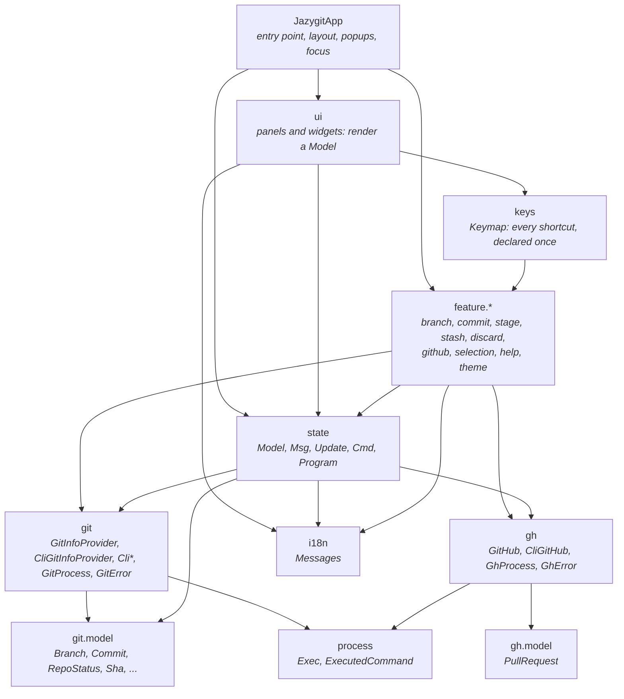
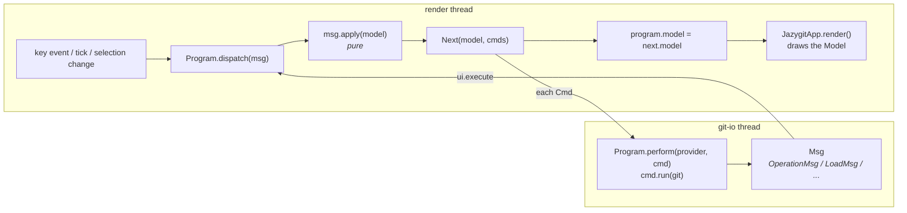
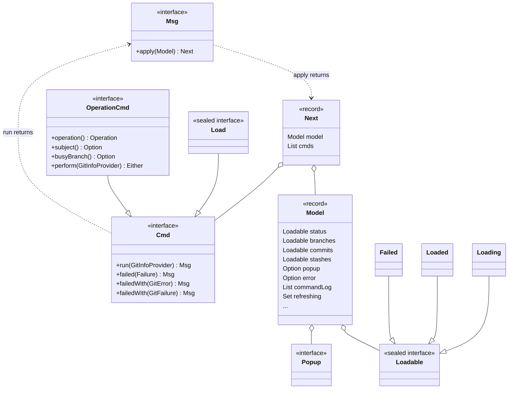
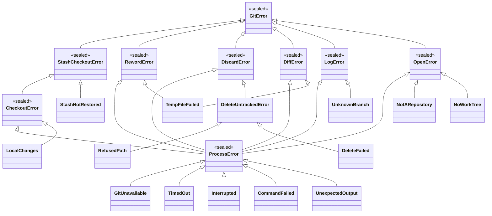
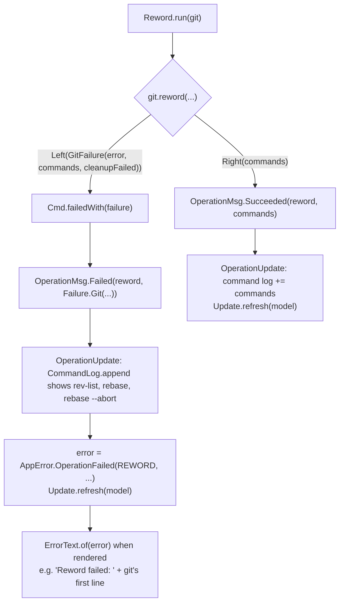

# jazygit architecture

jazygit is a lazygit-style terminal UI for git, built on [TamboUI](https://github.com/tamboui).
It follows the **Elm architecture**:

- The whole UI state is one immutable `Model`.
- Every event (a key press, a tick, a git result) is a `Msg`.
- A pure update function turns `(Model, Msg)` into the next `Model` plus the IO to perform, as `Cmd`
  values.
- Commands run against git (and, for GitHub, `gh`) on a background thread, and their outcome comes back as a
  new `Msg`.

Rendering never talks to git, and update functions never do IO.

## Packages



| Package | Responsibility |
|---|---|
| `JazygitApp` | Opens the repository, starts the `Program`, lays out the panes, shows the open popup and moves the focus. |
| `ui` | Panels (`FilesPanel`, `BranchesPanel`, `CommitsPanel`, `ContentPanel`, `CommandLogPanel`, ...) that render a `Model` and turn key events into `Msg`s; the dialog widgets (`ConfirmDialog`, `ChoiceDialog`, `TextInputDialog`); `ErrorText`, the only place that turns errors into text. |
| `keys` | `Keymap`: the keys of each panel (`Scope`) and the global keys. Panels react to keys from it, and the help popup lists them from it. |
| `feature.*` | One package per feature. Each one holds the feature's messages, its update functions, its commands, and its popups, dialogs and keys. |
| `state` | The Elm core: `Model`, `Msg`, `Update`, `Cmd`, `Program`, `Loadable`, `Preview`, the operations (`OperationCmd`, `OperationMsg`, `OperationUpdate`), the command log and the errors as data (`AppError`, `Failure`). |
| `git` | Everything that touches the repository, all through the `git` command line. All results are `Either` values. |
| `git.model` | Immutable value types describing the repository. |
| `gh` | Everything that talks to GitHub, all through the `gh` command line. It knows nothing of `git`, and `git` knows nothing of it; the features combine them. |
| `gh.model` | Immutable value types describing GitHub: `PullRequest`. |
| `process` | `Exec`, the only place that starts a program, for `git` and `gh` alike; `ExecutedCommand`, a command as it ran. |
| `i18n` | `Messages`: the user-facing texts, from `messages.properties`. |

## The runtime loop

`Program` holds the current `Model` and owns two executors:

- **ui**: the TamboUI render thread. It is the only thread that reads or replaces the model.
- **io**: a single `git-io` thread, so git commands never run concurrently.
- **background**: a `git-fetch` thread for commands that are slow and that nobody waits for
  (`Cmd.background()`), so they don't hold up the others. Today that is only the fetch.



Every 500 ms a `Msg.Tick` triggers `Update.refresh`, which re-reads the status, branches and stashes.
That keeps the screen in sync with changes made outside the app. A periodic load is skipped while an
equal one is still running: `Model.refreshing` holds the loads that are running.

Every minute a `FetchMsg.Tick` fetches from the remotes in the background, unless the previous fetch is
still running. `FetchUpdate` lists the remotes (those `git fetch --all` would fetch) and fetches them one after
the other with `git fetch <remote>`. `Model.fetching` holds the remote being fetched from, which the line at
the bottom of the screen shows, and the remotes still queued. When the queue is empty, the branches reload.
Neither the commands nor the failures are shown, since fetching also runs while offline, and a failing remote
doesn't stop the others. Once the fetch is done, the open pull requests are read again with `gh` (also once at
startup), into `Model.pullRequests`. While that runs, the line at the bottom says so, and
`Model.readingPullRequests` keeps another read from starting; a failure there is not shown either, as gh may
be missing or logged out. `ssh` runs with `BatchMode=yes` during the fetch, so it can't prompt for a passphrase
on the terminal.

## Core types



- **`Msg` applies itself.** Each feature has a sealed sub-interface, for example `RewordMsg`, whose
  `apply` delegates to that feature's update class (`RewordUpdate`). Adding a feature therefore needs
  no change to `Update` or `Msg`.
- **`Cmd` is immutable data** that knows how to run itself against an `Env` (the `GitInfoProvider` and the
  `GitHub`) and how to report failure:
  - `run` folds the provider's `Either` into a `Msg`.
  - `failed(Failure)` turns a failure into the failure `Msg`. A `Failure` is data: `Failure.Git` (the
    `GitError`, the commands that ran, and why the cleanup failed if it did), `Failure.GitHub` (the `GhError`
    and the commands that ran) or `Failure.Bug` (the command threw, which `Program.perform` catches).
- **`Cmd.Load`** reads part of the repository into the model, as a `Loadable`. Every `LoadMsg` names its
  load, so `LoadUpdate` marks it as no longer running in one place.
- **`OperationCmd`** changes the repository. It names its `Operation` (which holds the command log title
  and the error message), the branch it is done to, and the branch it keeps busy. Its outcome is an
  `OperationMsg.Succeeded` or `OperationMsg.Failed`, which `OperationUpdate` handles the same way for every
  operation: it logs the commands, releases the busy branch, stores an `AppError.OperationFailed` or clears
  the error, and reads the repository again. A feature only adds its own messages for outcomes that really
  are special, like `CheckoutMsg.NeedsStash`. A `GitOperationCmd` is one done through git alone: it only
  implements `perform(GitInfoProvider)`. The others, like creating a pull request, implement `run(Env)` themselves.
- **Errors are data until the view.** `Model.error` is an `Option<AppError>` and `Loadable.Failed` holds a
  `Failure`; `ErrorText` in `ui` turns them into text. `Model.fail` shows the error in the command log and
  opens an `ErrorPopup`, unless another popup is open, which then keeps what the user entered.
- **Popups are part of the model.** `model.popup()` says which dialog is open. `JazygitApp` renders the
  dialog that matches it and moves the focus into it, then back to the pane it came from once
  the popup closes.
- **The command log** (`Model.commandLog`) lists every git command that changed the repository, under the
  `Operation` that ran them, whether it succeeded or failed.

### The anatomy of a feature

Each feature package follows the same shape:

| Type | Example (reword) | Role |
|---|---|---|
| `XxxMsg` | `RewordMsg` | Sealed set of messages: `Requested`, `Confirmed`, `Cancelled`. |
| `XxxUpdate` | `RewordUpdate` | Pure transitions for those messages; `Update.confirm` closes a popup and starts the operation made of it. |
| `XxxCmd` | `CommitCmd.Reword` | The operation the feature asks for, an `OperationCmd`. |
| `XxxPopup` | `RewordPopup` | What the open dialog is about; it lives in the model. |
| `XxxDialogs` | `CommitDialogs.SQUASH`, `CommitDialog.reword` | The popups, mostly as data (`ConfirmDialog.Spec`, `ChoiceDialog.Spec`, `TextInputDialog.Spec`) that `JazygitApp` turns into widgets. |
| `XxxKeys` | `CommitKeys` | Adds the feature's keys to the immutable `Keymap`. |

## The git layer


- **Everything goes through the `git` command line**, so the repository is read and changed exactly as
  git itself does: its configuration, hooks, credentials and repository formats included.
  - **Reads:** `CliStatus` (`git status --porcelain=v2`), `CliBranches` (one `git for-each-ref` for all
    branches, with their upstream and ahead/behind counts), `CliLog` (`git rev-parse`, `git log -z`),
    `CliStash`, `CliDiff` and `CliShow`. Each has a pure parser for git's output.
  - **Writes:** `CliCheckout`, `CliBranch`, `CliIndex`, `CliRebase` and `CliStash`.
  - **Opening:** `CliGitInfoProvider.open` asks `git rev-parse` whether the directory is in a repository,
    whether that is bare, and where its working tree is.
- **`GitProcess.run(workTree, GitCommand)`** is the only place that starts git, through `process.Exec`:
  - A `GitCommand` is data: the arguments, the environment and a timeout.
  - Every command runs with `LC_ALL=C` (git's messages are matched in English) and
    `GIT_TERMINAL_PROMPT=0` (fail rather than wait for credentials).
  - It returns `Either<GitFailure<ProcessError>, Output>`.

## The GitHub layer

`gh.GitHub` is what the TUI does with GitHub; `CliGitHub` does it with the `gh` command line tool, which finds
the GitHub repository from the git remotes itself. It mirrors the git layer without depending on it:
`GhCommand` (run with `GH_PROMPT_DISABLED=1`), `GhProcess`, and its own errors, `GhError` and `GhFailure`.

- **Reading the pull requests:** `gh pr list --json ... --jq ...`. gh's built-in jq turns the JSON into one
  tab-separated line per pull request (fork pull requests left out), which `CliGitHub.parse` reads; there is
  no JSON library. The CI checks are folded into one state: failing, else pending, else passing.
- **Creating and opening:** `gh pr create --head <branch on the remote> --base <base> --fill` and
  `gh pr view <n> --web`. The name of the branch on its remote comes from git
  (`GitBranches.remoteBranch`): `PullRequestCmd.CreatePullRequest` asks git, then gh.

### Errors as values

No git operation throws. A read returns `Either<E, T>`. An operation that changes the repository
returns `Either<GitFailure<E>, List<ExecutedCommand>>`:

- On success, the right side is the commands that ran.
- On failure, a `GitFailure` pairs the error with the commands that ran up to and including the
  failing one.

An `ExecutedCommand` holds the program and its arguments as they were run; `line()` writes it as one would
type it in a shell, which is how the command log shows it.

`E` is the narrowest error type the operation can produce, so its signature lists every way it can
fail.



Some helpers combine these results:

- `GitFailure.sequence(...)` runs steps in order and stops at the first failure. That failure also
  carries the commands of the steps before it.
- `GitFailure.widen(...)` views a failure as a wider error type, for example a `ProcessError` as a
  `RewordError`.
- `GitFailure.followedBy(cleanup)` adds the commands of a cleanup, like `git rebase --abort`, and records in
  `cleanupFailed` why it failed, if it did.
- `GitProcess.log`, `read`, `ask` and `runOrUndo` run a command for its effect, to read something, to ask a
  question git answers "no" to by exiting with 1 silently, or with an undo when it fails.

Parsing never throws: the parsers in `GitOutput` and the `Cli*` classes return
`Either<UnexpectedOutput, T>`, so output git was not expected to print is a `ProcessError` like any other.
The git package returns data, not messages; `ErrorText` in `ui` turns errors into text.

## Example: rewording a commit

The user selects a commit in the commits pane, presses `r`, edits the message and confirms. The flow
below shows what happens.


### Step by step

1. **Key press.**
   - `CommitKeys` registered `Binding.onSelected("r", "help.commits.reword", RewordMsg.Requested::new)`
     in the `COMMITS` scope.
   - `CommitsPanel` asks the `Keymap` to handle the key with the selected index. That yields
     `RewordMsg.Requested(index)`, which the panel dispatches.

2. **Open the dialog**, a pure step in `RewordUpdate.requested`. If the commits are loaded and the
   index is valid, the model gets a `RewordPopup(commit)` and the error is cleared. No IO is needed.

3. **Render.**
   - `JazygitApp.render` asks each dialog to render. `CommitDialog.reword` renders because
     `model.popup(RewordPopup.class)` is defined, and starts out with the commit's current message.
   - `JazygitApp` moves the focus into the dialog.

4. **Confirm**, a pure step in `RewordUpdate.confirmed`.
   - A blank summary keeps the dialog open.
   - Otherwise `Update.confirm` closes the popup and returns one command: `CommitCmd.Reword(sha, message)`.

5. **Perform**, on the `git-io` thread. `Program.perform` calls `Reword.run(git)`, which `OperationCmd`
   implements for every operation:

   ```java
   return perform(git).fold(this::failedWith, this::succeeded);
   ```

   where `Reword.perform` is `git.reword(sha, message)`.

6. **The git work**, in `CliRebase.rewordAny`.
   - `CliLog.resolve(workTree, "HEAD")` runs `git rev-parse --verify --quiet HEAD^{commit}` to find out
     whether the commit is `HEAD`. If that fails, it's a `ProcessError`, which is a `RewordError`.
   - **The commit is `HEAD`:** `CliIndex.reword` runs `git commit --allow-empty --amend --only -m … [-m …]`.
     Its `ProcessError` is widened to a `RewordError`.
   - **An older commit:** `CliRebase.reword` does the following.
     1. `TempFiles.using` writes the new message to a temporary file. If that fails, it's a
        `TempFileFailed`.
     2. `base` runs `git rev-list --parents -n 1 <sha>` to decide between `<sha>^` and `--root`.
     3. It runs `git rebase --interactive --autostash --keep-empty --rebase-merges <base>` with
        `GIT_SEQUENCE_EDITOR` set to a `sed` script that turns `pick <sha>` into `reword <sha>` (and
        `merge -C` into `merge -c`). `GIT_EDITOR` is set to `cp <message file>`.
     4. If the rebase fails, `GitProcess.runOrUndo` runs `git rebase --abort`, and that line joins the
        failure's command log. If the abort fails too, the failure records why. The repository is left as
        it was.

7. **Report.** The `Either` becomes one of two messages, which `OperationUpdate` handles:
   - **Success:** `OperationMsg.Succeeded(reword, commands)`. The commands are logged under
     `Operation.REWORD`, the error is cleared and `Update.refresh` reads the repository again.
   - **Failure:** `OperationMsg.Failed(reword, Failure.Git(error, commands, cleanupFailed))`. The commands
     that ran, including the abort, are logged; `Model.error` becomes
     `AppError.OperationFailed(REWORD, none, failure)`, which `ErrorText` shows as `"Reword failed: …"`;
     and the repository is read again.

8. **Refresh.** `Update.refresh` starts `LoadStatus`, `LoadBranches` and `LoadStashes`.
   - When `StatusLoaded` arrives, `LoadUpdate.statusLoaded` sees that `HEAD` moved (the reworded
     commit and everything after it have new shas) and issues `LoadCommits`.
   - When `CommitsLoaded` arrives, the commits pane shows the new message.

### The failure path



## Testing

- **Update functions** are pure, so most tests build a `Model` (`TestModels`), apply a `Msg` and
  assert on the next model and its commands. No git is involved.
- **`ProgramTest`** runs the real loop with queue executors and a fake provider (`StubGitProvider`
  gives every method a default).
- **The git layer** is tested against real temporary repositories: `CliGitInfoProviderTest`,
  `CliCheckoutTest`, `CliDiscardTest`, `CliDiffTest` and `GitProcessTest`. The parsers
  (`CliStatus.parse`, `CliBranches.parse`, `CliLog.parse`) are tested on fixed git output in
  `CliStatusTest` and `CliParseTest`.
- **UI tests** use TamboUI's `ToolkitTestRunner` and its pilot.
