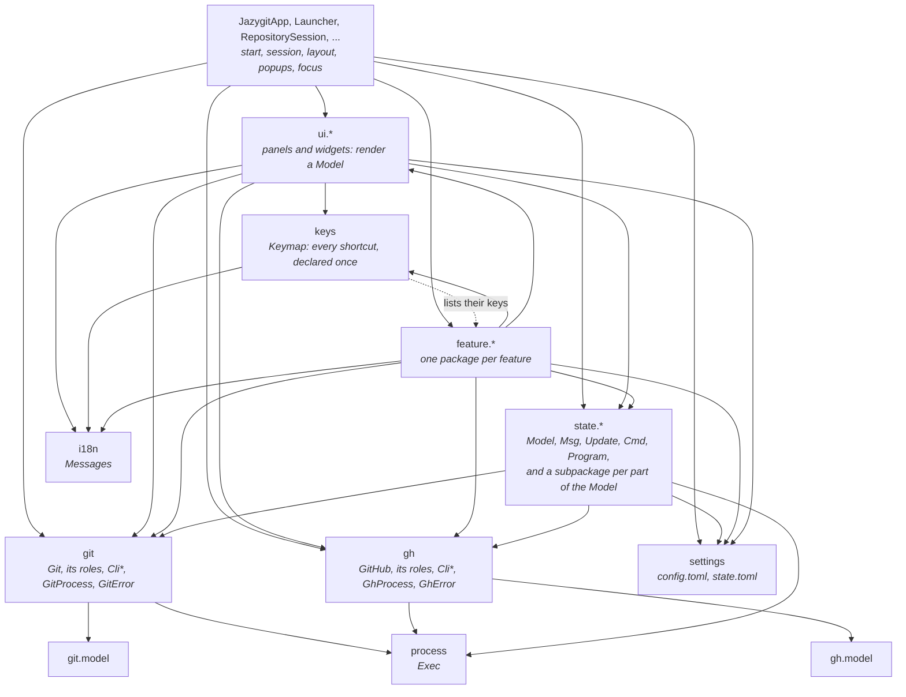
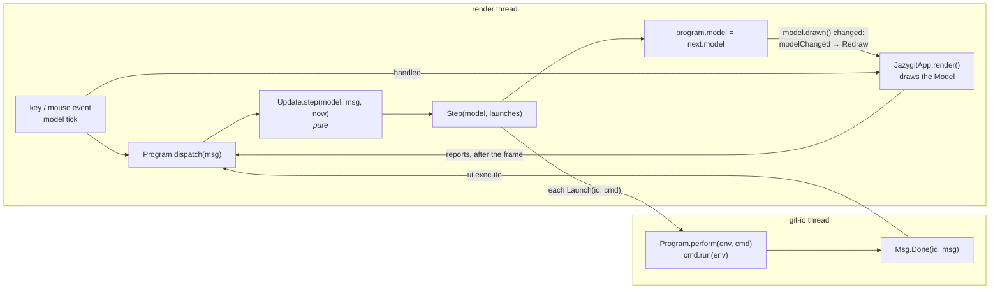
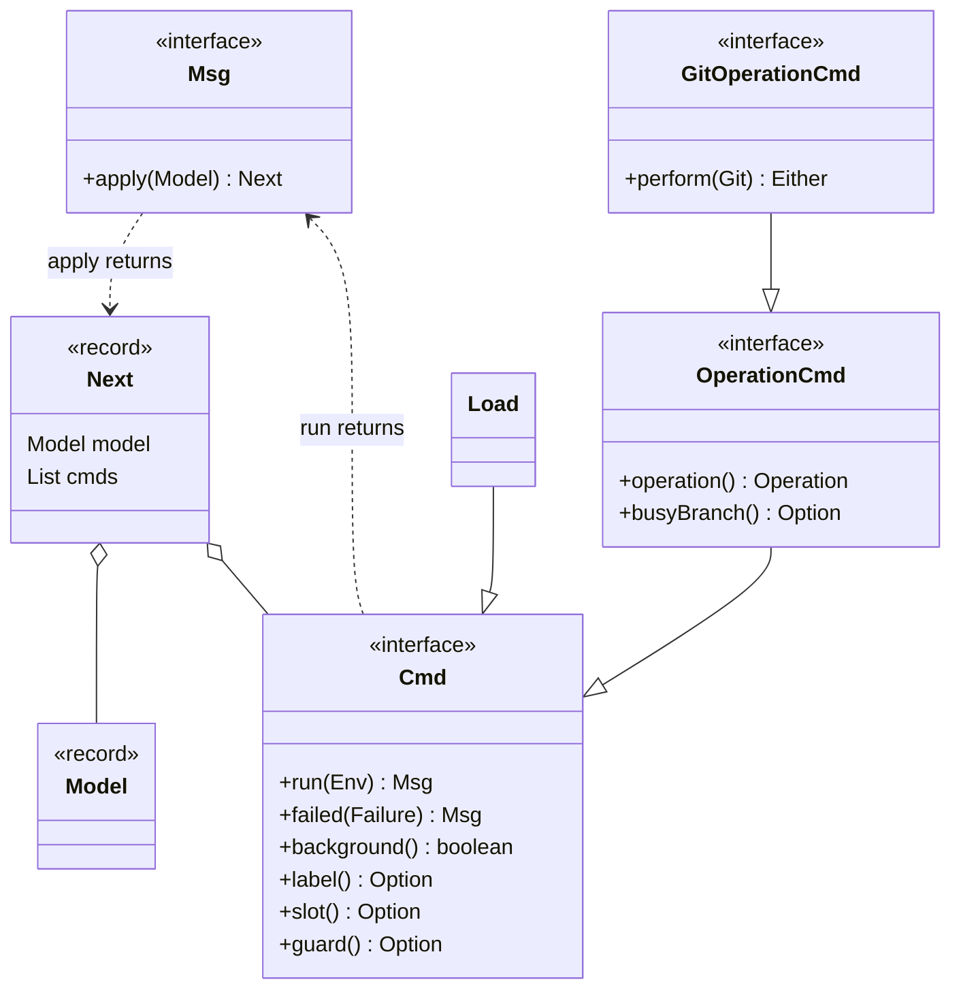
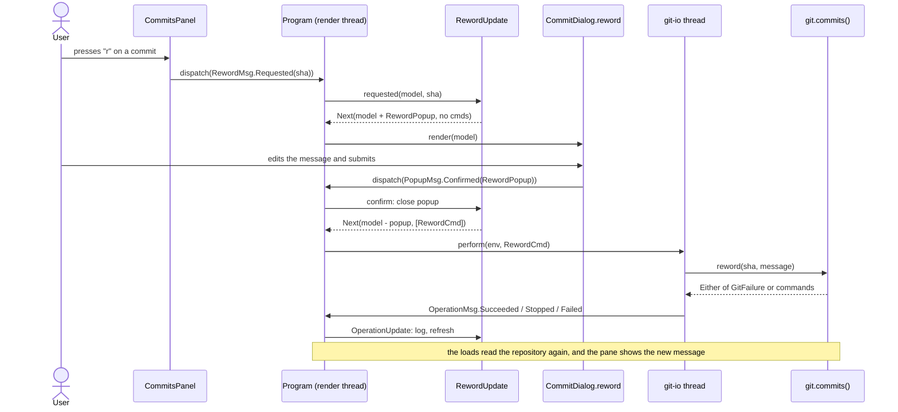

# jazygit architecture

jazygit is a lazygit-style terminal UI for git, built on [TamboUI](https://github.com/tamboui).
It follows the **Elm architecture**:

- The whole UI state is one immutable `Model`.
- Every event (a key press, a tick, a git result) is a `Msg`.
- A pure update function turns `(Model, Msg)` into the next `Model` plus the IO to perform, as `Cmd`
  values.
- Commands run against git (and, for GitHub, `gh`) on a background thread, and their outcome comes back as a
  new `Msg`.

Rendering never talks to git, and update functions never do IO.

This file is a map of the shape of the code: the modules, the layers, the loop and what a feature is made of. It
does not describe features; the code, its Javadoc and the tests do. Why things are as they are is in the ADRs, in
`documentation/adr`. Change this file only when the shape changes.

## Modules

| Module | Holds | Depends on |
|---|---|---|
| `jazygit-json` | `json`: JSON as plain values, and decoders into records (ADR 42). | vavr, Parsson |
| `jazygit-syntax` | `syntax`: the lexer that finds the tokens of a line of code (ADR 53, 113). | vavr |
| `jazygit-process` | `process`: running a program, and what it did as a value (`Exec`, `ExecutedCommand`). | vavr, zt-exec |
| `jazygit-git` | `git`, `git.model`: running git, and what it reports as values. | process, syntax |
| `jazygit-gh` | `gh`, `gh.model`: running gh, and what GitHub reports as values. | process, json |
| `jazygit-app` | Everything else: `JazygitApp`, `state`, `feature.*`, `ui`, `keys`, `settings`, `i18n`. Builds the fat jar and the native image. | git, gh, TamboUI, picocli, night-config |
| `jazygit-test-support` | What the architecture tests share (`CoreRules`, `ModelRules`). Test scope only. | ArchUnit |
| `jazygit-benchmarks` | JMH benchmarks, only built with `-Pbench`. | git, app, JMH |

The packages keep their names (`net.vanfleteren.jazygit.git`, ...), whichever module they are in. The core
(`process`, `git`, `gh`, `json`, `syntax`) cannot see the application, TamboUI, picocli or night-config, and git and
gh cannot see each other, so the compiler stops any such dependency. The rules inside the core (the models are pure,
failures are values) are ArchUnit tests: `CoreRules` and `ModelRules`, run by each module's `*ArchitectureTest`.

## Packages

The arrows are the dependencies allowed. Inside `jazygit-app`, `ArchitectureTest` fails on any other; it is the
source of truth when the two disagree.

- **The parts have no cycles**, with one exception: `Keymap.standard()` lists the keys of the features, which
  declare them with the types of `keys` (dotted).
- **Nor have the subpackages of `state`** (`diff`, `view`, `load`, `github`, `operation`, `popup`, `compose`, `index`,
  `preferences`). `state` itself uses them all, and they all use it, as the `Model` holds them.
- **Nor have the subpackages of `ui`**, which follow the panes: the shell (`ui` itself: `LeftColumn`, the status
  and command log panels) → `content` → the panes (`branches`, `commits`, `files`, `stash`, `github`) and `diff` →
  `markdown`, `widgets`, `edit` → `text`, `theme`. Nothing in them uses the shell (`uiIsFreeOfCycles`,
  `uiPartsDoNotUseTheShell`).
- **Views use `ui` only to draw.** Nothing in `ui`, `keys` or a dialog runs git or gh. `ui.text.ErrorText` is the only
  place that turns errors into text.
- **Only views use `i18n`.** `state` does not.
- **`settings` knows nothing of the application**, and is the only part that reads or writes TOML.

## The runtime loop

`Program` holds the current `Model`. `RepositorySession` gives it three executors:

- **ui**: the TamboUI render thread. It is the only thread that reads or replaces the model.
- **io**: a single `git-io` thread, so the commands the user asks for never run concurrently.
- **background**: a `git-fetch` thread for slow commands nobody waits for (`Cmd.background()`), like the fetch.
  Commands that write remote-tracking refs or `FETCH_HEAD` name a `Cmd.guard()`, so they run one after the other
  wherever they run (ADR 27).

Every command answers with a `Msg`, also one that throws: `Program.perform` turns that into a `Failure.Bug`.

- **A frame is drawn only when asked for** (ADR 14): after an event that is handled, when `Model.drawn()` changed, or
  through `JazygitApp.requestRedraw()` for what the model does not see. Anything that changes the screen without
  either must ask for a frame itself.
- **The view reports back.** Cursors and focus live in the widgets (ADR 2). After each frame,
  `JazygitApp.reports` compares the widgets with the model and dispatches what differs (`SelectionMsg`,
  `ViewMsg.Focused`). This is the only way the view tells the model something no user event did.
- **What runs is in the model.** `Update.step` stamps each command with an id into `Jobs.running`; `Msg.Done`
  takes it out (ADR 39). Busy branches, running loads and the activity line all derive from that.
- **The repository is read on ticks**, guarded by stamps of git's files so an idle app runs almost no git
  (ADR 15, 58, 67, 93).

## Core types

- **`Msg` applies itself.** Each feature has a sealed sub-interface (`RewordMsg`) whose `apply` delegates to that
  feature's update class (`RewordUpdate`), so adding a feature changes neither `Update` nor `Msg`.
- **`Cmd` is immutable data** that runs itself against an `Env` (the `Git` and the `GitHub`) and folds the `Either`
  it gets into a `Msg`, a failure through `failed(Failure)`.
- **`Load`** reads part of the repository into the model as a `Loadable` (`Loading`, `Loaded`, `Failed`).
- **`OperationCmd`** changes the repository. Its outcome is `OperationMsg.Succeeded`, `Stopped` (on conflicts) or
  `Failed`, which `OperationUpdate` handles alike for every operation: log the commands, free the branch, store the
  error or notice, read the repository again. A `GitOperationCmd` needs only `perform(Git)`.
- **Errors are data until the view.** An `AppError` says itself as a `Phrase` (a message key and its arguments);
  `ErrorText` turns it into text. Each feature keeps its own sealed `XxxError`.
- **Popups, and what is typed in them, are part of the model** (ADR 2, 38). `model.popup()` says which dialog is
  open; Escape and Enter go through `PopupMsg.Dismissed` and `PopupMsg.Confirmed` unless a feature needs more.
- **Cursors and focus are view state** (ADR 2): they live in TamboUI, and the model learns what they point at from
  the reports above.

### The anatomy of a feature

Each feature package follows the same shape:

| Type | Example (reword) | Role |
|---|---|---|
| `XxxMsg` | `RewordMsg` | Sealed set of the feature's messages. |
| `XxxUpdate` | `RewordUpdate` | Pure transitions for those messages. |
| `XxxCmd` | `RewordCmd` | The IO the feature asks for, usually an `OperationCmd` with its `Operation`. |
| `XxxPopup` | `RewordPopup` | What the open dialog is about; it lives in the model. |
| `XxxDialogs` | `CommitDialog.reword` | The dialogs, mostly as data (`ConfirmDialog.Spec`, ...), as `PopupSlot`s. |
| `XxxKeys` / `XxxAction` | `DropAction` | The keys, added to the immutable `Keymap`; an action bundles one operation's keys and popups. |
| `XxxFeature` | `CommitFeature` | Lists a feature's actions: what `Keymap` and `Popups` know of it. |

The larger features (commit, branch, github, worktree) give each operation a subpackage holding all of the above;
adding an operation is adding its subpackage and one line in the `XxxFeature`.

## The git and GitHub layers

- **Everything goes through the command line**, `git` and `gh`, so the repository is read and changed exactly as git
  does, with its configuration, hooks and credentials.
- **Roles** (ADR 69, 114): `Git` and `GitHub` are records holding one interface per role (`Stashes`, `Branches`,
  `PullRequests`, `Reviews`, ...), each implemented by a package-private `Cli*` class. Tests replace the roles they
  need on `StubGit.of()` and `StubGitHub.of()`.
- **One place starts a process:** `GitProcess` and `GhProcess`, both through `process.Exec`. A command is data
  (arguments, environment, timeout) and never prompts: no terminal credentials, no editor, ssh in batch mode.
- **gh's JSON** is decoded with the `Decoder`s of `jazygit-json` (ADR 42), one query class per read.
- **Errors as values.** Nothing throws on purpose. A read returns `Either<GitError, T>`; a write returns
  `Either<GitFailure, List<ExecutedCommand>>`, the failure carrying the commands that ran (ADR 75). Parsers return
  `Either` too. `Unfinished.runOrUndo` leaves a merge or rebase stopped on conflicts for the user, and undoes one that
  stopped half-way otherwise.

## Example: rewording a commit

## Testing

- **Update functions** are pure: build a `Model` (`TestModels`), apply a `Msg`, assert on the next model and its
  commands. No git involved.
- **`ProgramTest`** runs the real loop with queue executors and `StubGit`.
- **The git layer** is tested against real temporary repositories; its parsers on fixed git output.
- **UI tests** use TamboUI's `ToolkitTestRunner` and its pilot, and assert on the rendered screen.
- **Acceptance tests** (`acceptance/`, Python) run the built jar in a pseudo terminal and check the repository with
  git; see [acceptance/README.md](acceptance/README.md).
- **`ArchitectureTest`** and the core's `*ArchitectureTest`s enforce the rules above.
