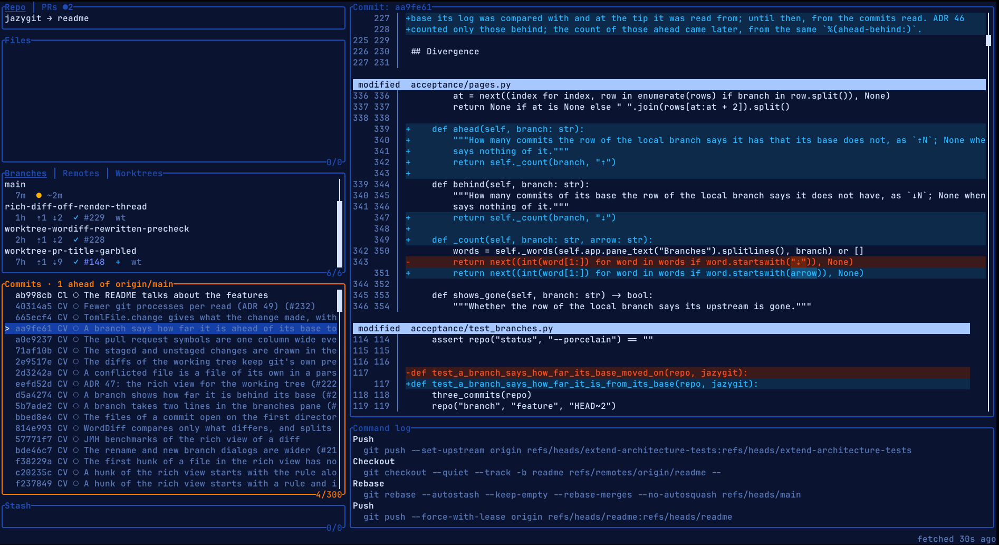
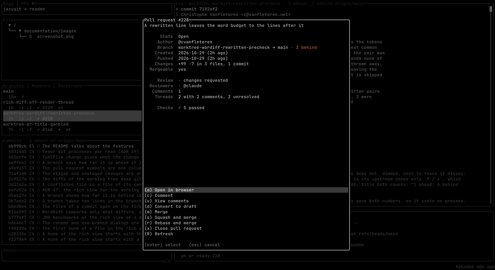

# jazygit

Git and your pull requests, their reviews and their CI, in one terminal UI. In the spirit of
[lazygit](https://github.com/jesseduffield/lazygit), written in Java on [TamboUI](https://github.com/tamboui).

## Highlights

- **Pull requests on the branches.** Every branch shows its pull request: draft or not, its review (approved,
  changes requested, to review), its CI (passed, failed, running, queued), whether it is merging or in the merge
  queue, and how far it is ahead of and behind its base.
- **Stacked pull requests,** shown as a stack and merged together with the ones below them.
- **CI checks, one by one:** how long each took, or how long a running one should still take, estimated from how
  long it took before.
- **Rewrite history in a keystroke:** reword or amend any commit, squash, fixup, drop or revert one, move commits
  you made on the wrong branch onto a new one, cherry-pick, and search the whole history by message, author, path
  or changed text.
- **A pull requests screen** (Ctrl+P): this repository's open pull requests, the ones waiting for your review and
  your own, to read, comment on, merge or check out.
- **Worktrees:** a branch, or a pull request, in a new worktree in one key. Switch between them, lock and prune them.
- **A rich diff view** (Ctrl+D) with line numbers and the changed words highlighted, for the working tree, commits
  and stashes.
- **One GitHub account per repository,** without switching gh's active account.
- **Recent repositories** (Ctrl+R), and outside a repository it offers to `git init` it or open another one.

Press `?` in any pane for all its keys. There are several themes, a colour-blind friendly one among them.

## Getting it

Download the jar, or the native Linux executable, from [Releases](https://github.com/cvanfleteren/jazygit/releases).
To build it yourself, see [CONTRIBUTING.md](CONTRIBUTING.md).

## Requirements

- git 2.45 or newer.
- [gh](https://cli.github.com/) 2.48 or newer, logged in with `gh auth login`, for the GitHub features. Everything
  else works without it.
- Java 25, unless you run the native executable.
