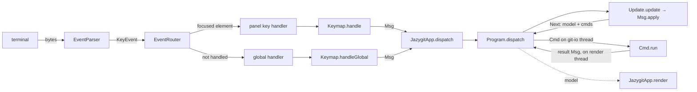
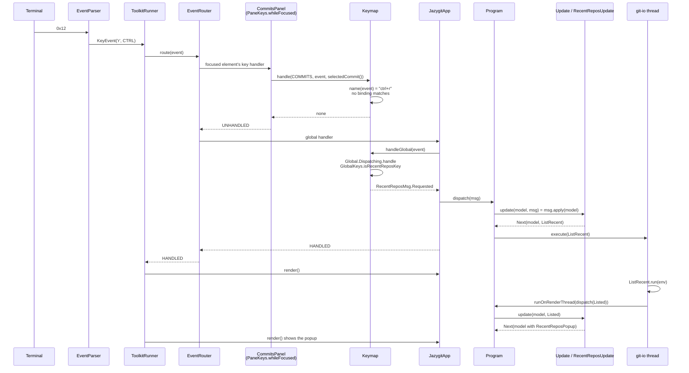

# Key handling

How a key press travels from the terminal to a change on screen: TamboUI turns it into a `KeyEvent` and routes
it to an element, the `Keymap` turns it into a `Msg`, and the `Program` applies that message to the `Model` and
runs the IO it asks for. The screen is then drawn again from the new model.

## Overview



## Step by step

### 1. From bytes to a `KeyEvent` (TamboUI)

`dev.tamboui.tui.event.EventParser` reads the bytes from the terminal and makes a `KeyEvent`: a `KeyCode`
(`CHAR` for a character, or `ENTER`, `ESCAPE`, `UP`, ...), `KeyModifiers` (ctrl, alt, shift) and the
character. A Ctrl+letter arrives as the lowercase letter with `CTRL` held: Ctrl+R is `ofChar('r', CTRL)`, and
`event.string()` is `"r"`, the same as for a plain `r`. Only the modifiers tell the two apart.

### 2. Routing the event (TamboUI)

`ToolkitRunner.handleEvent` hands every event to `EventRouter.route`, and draws the screen again when the
event was handled. `EventRouter.routeKeyEvent` tries these in order, and stops at the first that handles the
key:

1. **Tab / Shift+Tab** move the focus (`FocusManager.focusNext` / `focusPrevious`).
2. **The focused element**: first its `handleKeyEvent(event, true)`, then the handler set with
   `onKeyEvent(...)`.
3. **The global handlers**, in the order they were added with `eventRouter().addGlobalHandler(...)`.
4. **All other elements**, with `handleKeyEvent(event, false)`.
5. **Escape** clears the focus.

If nothing handled the key and it is the quit key, `ToolkitRunner` quits.

Two consequences:

- **A panel sees a key before the global keys do.** If a panel binds a key that is also global, the panel's
  key wins while that panel has the focus.
- **Unfocused elements also get the keys** that nothing else handled (step 4). That is why the panels wrap
  their handlers in `PaneKeys.whileFocused`, which ignores keys while the panel does not have the focus.

### 3a. A panel key

Each list panel installs its handler in its constructor through `LoadableList.onKey`, which wraps it in
`PaneKeys.whileFocused`. For example, in `CommitsPanel`:

```java
list.onKey(event -> event.code() == KeyCode.ENTER && selectedCommit().isDefined()
        ? Option.of(openCommit)
        : PaneKeys.sending(keymap.handle(Scopes.COMMITS, event, selectedCommit()), dispatch));
```

Keys that only move the focus or the view, like Enter here, are handled in the panel itself. All other keys go
to `Keymap.handle(scope, event, selection)`:

- `?` gives a `HelpMsg.Requested`, with the action each key of the panel would have for the current selection.
- Otherwise it looks up the `Binding` of the scope that `Binding.matches(event)`. A binding's `key` is named
  as `Keymap.name(event)` names the event: the character, with `ctrl+` and `alt+` in front when those are held
  (`"r"`, `"ctrl+x"`, `" "` for space). Shift is not in the name, as it is already in the character (`"A"`).
- The binding's `action` is applied to the selection. `Binding.onSelected` gives no message when nothing is
  selected; `Binding.always` always gives one.

`PaneKeys.sending` turns the `Option<Msg>` into a `Runnable` that dispatches the message, and
`PaneKeys.whileFocused` runs it and returns `HANDLED`. With no message, the result is `UNHANDLED`, and the
router goes on to the global keys.

### 3b. A global key

`JazygitApp.onStart` registers one global handler, which asks `Keymap.handleGlobal(event)` for a message and
dispatches it. `handleGlobal` asks each `Keymap.Global` in turn. The `Global.Dispatching` implementation checks
the event with a predicate, such as `GlobalKeys.isRecentReposKey` (Ctrl+R) or `GlobalKeys.isQuitKey` (`q`),
and supplies the message, such as `RecentReposMsg.Requested`.

### 3c. A key in the help dialog

While the help popup is open, its list has the focus, so `HelpDialog.handleKey` gets the key first:

- Escape or `?` dispatches `HelpMsg.Closed`.
- Enter runs the highlighted row; up and down move between the rows.
- Any other key runs the row it matches: the panel's bindings first (`Binding.matches`), then the global keys
  (`Global.handle`).

Running a row dispatches `HelpMsg.Chosen(msg)`. `HelpUpdate` closes the popup and applies `msg` to the model,
as if the key had been pressed in the panel. `Msg.Quit` is dispatched as it is, because only the app can quit.

### 4. Where the keys are declared

`Keymap.standard()` returns `Standard.KEYMAP`, which is built by folding each feature's `register` over
`Keymap.empty()`: `StageKeys`, `CommitFeature`, `CherryPickKeys`, `DiscardKeys`, `EditKeys`, `StashKeys`,
`BranchFeature`, `GitHubFeature`, `WorktreeFeature` and `GlobalKeys`. An `XxxFeature` registers the keys of each
of its operations, in the order it lists them. A feature adds its panel keys with `Keymap.add(scope, bindings...)`, which refuses a key bound
twice in the same panel, and adds its global keys with `Keymap.global(...)`. The panels and the help dialog read
the same keymap, so the help always lists the keys that work.

### 5. Dispatching the message

`JazygitApp.dispatch` is the `Consumer<Msg>` that all panels and dialogs get. Every message, `Msg.Quit` too, goes
to `Program.dispatch`, on the render thread. `Msg.Quit` may be refused, while a popup holds typed input; the
runner stops only when the `Next` it returns has `quit` set. While a popup is open, the global handler takes
every key, so what the popup leaves unhandled reaches neither the global keys nor TamboUI's quit key:

1. `Update.update(model, msg)` calls `msg.apply(model)`. Every feature has its own `Msg` sub-interface whose
   `apply` delegates to that feature's update function, such as `RecentReposUpdate.update` or
   `RewordUpdate.update`. These functions are pure and return a `Next`: the new model and the `Cmd`s to run.
2. `Program.apply` stores the new model and runs each `Cmd` on the `git-io` executor (or the `git-fetch`
   executor for a `background()` command), so git runs off the render thread, one command at a time.
3. `Cmd.run(env)` does the IO and returns a message with the result. A command that throws gets
   `Cmd.failed(...)`. The result goes back to the render thread through `runner::runOnRenderThread`, and is
   dispatched like a key's message.

### 6. Drawing

After the event, TamboUI draws again. `JazygitApp.render()` reads `program.model()` and renders the panels and
popups from it. A popup opened by the model, such as `RecentReposPopup`, appears on that render.

## Sequence: Ctrl+R in the commits panel

The commits panel has `r` (reword) but not `ctrl+r`, so the panel leaves the key, and the global key opens the
recent repositories.



Pressing plain `r` follows the same route until `Keymap.handle`: there `name(event)` is `"r"`, the reword
binding matches, and the panel dispatches `RewordMsg.Requested(sha)` and returns `HANDLED`, so the global
handlers never see the key.
